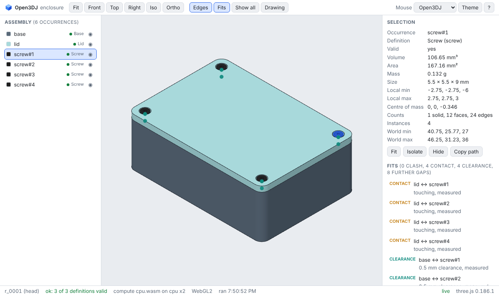

# Open3DJ

**Open-source, agent-first CAD** for precise parts that people and AI agents design together.

Open3DJ is open-source, agent-first, local-first CAD. It does precise parametric B-rep modeling, the exact solid geometry that engineering and manufacturing depend on. AI agents drive it over the [Model Context Protocol](https://modelcontextprotocol.io) (MCP) and a command-line interface, and people work in a professional desktop app. It will install on Windows, macOS and Linux, run on your own computer, and use cloud GPUs only when you choose to plug them in. It also covers the industrial product design pipeline, from a brief and a concept through design for manufacture to a clean handoff to suppliers.

Open3DJ is created by **Neural Deep Network LTD** ([neuraldeep.net](https://www.neuraldeep.net)), based in Dublin and Malta, EU. It is built in the open by the founder, volunteers, AI agents and the organizations that join us.

## Why Open3DJ

- **Agents can check their own work.** Open3DJ is designed so that every change produces measurable evidence (volume, bounding box, validity, renders) that a person or an agent can verify.
- **Assemblies from day one.** Every design is an assembly: named parts, reusable part definitions, sub-assemblies, interference checks and multi-part STEP and glTF export. A single part is simply a one-part assembly.
- **CPU and GPU.** The precise geometry is computed on the CPU, across several cores. GPUs speed up the viewer, rendering, analysis, simulation and generative models, with a CPU fallback whenever no GPU is available. Cloud GPUs plug in only when you choose.
- **Local-first.** Your files stay on your machine unless you choose to send them somewhere.
- **Your designs are yours.** What you create with Open3DJ belongs to you.
- **From idea to a part someone can make.** Exports and checks aimed at 3D printers, print services and manufacturers.

## Status: first vertical slice

Open3DJ is early. The first slice works end to end on the command line and over MCP: a script in the Open3DJ DSL goes in, and a checked assembly, a short GeometryReport, a four-view drawing (PNG and SVG) and STEP, STL, glTF and 3MF files come out. A local browser viewer shows the result in 3D and follows every save. There is no desktop app yet, and many DSL entries are still to come (see [docs/DSL.md](docs/DSL.md)). This is the best time to shape it.

- [docs/GETTING-STARTED.md](docs/GETTING-STARTED.md): your first part, for people and for agents.
- [examples/](examples/README.md): ten small parts and assemblies with their measured results and drawings.
- [docs/PLAN.md](docs/PLAN.md): the lean plan, how we work (the Kaizen loop) and the roadmap of small releases, S0 to S12.
- [docs/ARCHITECTURE.md](docs/ARCHITECTURE.md): the technical architecture, contracts, agent tools and repo layout.
- [docs/ASSEMBLIES.md](docs/ASSEMBLIES.md): the assembly-first model: parts, occurrences, mates, fits, BOM and exports.
- [docs/COMPUTE.md](docs/COMPUTE.md): how work runs on CPU, local GPU and cloud GPU, with a CPU path for everything.
- [docs/INDUSTRIAL-DESIGN.md](docs/INDUSTRIAL-DESIGN.md): the industrial product design pipeline, from brief to supplier handoff.
- [docs/research/README.md](docs/research/README.md): research on AI CAD, geometry kernels, agent protocols, security, licensing and more, dated 2026-10-27.

## Try it

You need [Node.js 24](https://nodejs.org) and git. Nothing is published to npm yet, so you run Open3DJ from a clone:

```sh
git clone https://github.com/NeuralDEEPnet/Open3DJ.git
cd Open3DJ
npm ci
npx open3dj run examples/bracket/bracket.o3j.js
npx open3dj render examples/bracket/bracket.o3j --out bracket.png
npx open3dj export examples/bracket/bracket.o3j --format step
```

`run` prints the report: validity, volume, bounding box and counts for every part, and clashes, contacts and clearances between parts. `render` writes a four-view drawing, and `export` writes the STEP file and an evidence sidecar under `examples/bracket/bracket.o3j/out/r_0001/`. Start your own design with `npx open3dj new mypart` (or `--template assembly`).

**See it in 3D.** `npx open3dj view examples/enclosure/enclosure.o3j.js` opens a local browser viewer with the assembly tree, the measures of the selected part and the fit markers, and it updates every time you save the script.



**Connect an AI agent.** Open3DJ is an MCP server with five tools: `run`, `inspect`, `render`, `export` and `docs`. For Claude Code, run this in the folder where your designs should live:

```sh
claude mcp add open3dj -- node /path/to/Open3DJ/packages/open3dj/src/cli.ts mcp
```

Then ask, for example, "make a 60 mm wall bracket with two M4 holes, check it and export STEP". To load the server and the agent skill together, start Claude Code with the plugin in this checkout instead: `claude --plugin-dir /path/to/Open3DJ/skills/claude-code-plugin`. Other clients (Codex, Gemini CLI, Cursor, VS Code, Claude Desktop) take the same command, `node /path/to/Open3DJ/packages/open3dj/src/cli.ts mcp`, in their MCP settings, and should get [skills/open3dj/SKILL.md](skills/open3dj/SKILL.md) as instructions (the DSL essentials, the error-fix loop and the assembly rules); [docs/GETTING-STARTED.md](docs/GETTING-STARTED.md) shows each one. Everything runs on your computer.

## Get involved in one minute

People, AI agents operated by people, and organizations are all welcome. Many first tasks need no code and no git.

| You are | Your first step |
|---|---|
| **A person** (designer, engineer, maker, developer, writer, student) | [Pick a form](https://github.com/NeuralDEEPnet/Open3DJ/issues/new/choose): [Standard part proposal](https://github.com/NeuralDEEPnet/Open3DJ/issues/new?template=part_library.yml), [Industrial design pipeline](https://github.com/NeuralDEEPnet/Open3DJ/issues/new?template=industrial_design.yml) or [Research check](https://github.com/NeuralDEEPnet/Open3DJ/issues/new?template=research_check.yml). No git, no code. New to GitHub? [Create a free account](https://github.com/signup) first. |
| **Using an AI agent** (Claude Code, Codex, Cursor, a custom MCP agent) | Point it at [AGENTS.md](AGENTS.md) and try one of the [starter tasks for agents](CONTRIBUTING.md#your-agents-first-task). |
| **Representing an organization** (company, university, lab, makerspace, print service, open-source project) | See [For organizations](CONTRIBUTING.md#for-organizations), or fill in the [Organization offer](https://github.com/NeuralDEEPnet/Open3DJ/issues/new?template=organization.yml) form. |

Then read [CONTRIBUTING.md](CONTRIBUTING.md) for the full guide. Questions are welcome in [Q&A on GitHub Discussions](https://github.com/NeuralDEEPnet/Open3DJ/discussions/categories/q-a). Every contributor is credited in [CONTRIBUTORS.md](CONTRIBUTORS.md) and in release notes, and agents are credited through their operators.

## How we work

We work in a lean, Kaizen style: small usable releases, a weekly plan-do-check-act review, stop the line on regressions, and every failure root-caused into a regression test. [AGENTS.md](AGENTS.md), [CONTRIBUTING.md](CONTRIBUTING.md) and the issue and pull request templates are our standard work. We are blameless and curious: a well-documented experiment that did not work is still a contribution.

## License

- **Today:** [MIT](LICENSE), "Copyright (c) 2026 Neural Deep Network LTD and the Open3DJ contributors".
- **Proposed, not decided:** a dual license, MIT OR Apache-2.0, for Apache-2.0's patent grant. This is a pending founder decision.
- **Contributions:** sign off each commit under the [Developer Certificate of Origin](CONTRIBUTING.md#sign-your-work-the-developer-certificate-of-origin). There is no CLA, and you keep your copyright.
- **Third parties:** no GPL or AGPL code in the core. Open CASCADE (LGPL-2.1 with an exception) stays dynamically linked or runs as WebAssembly, as its terms require. Generative models with restrictive licenses are opt-in packs only.
- **Your designs belong to you.** The license covers the Open3DJ software, not what you make with it.

[docs/LICENSING.md](docs/LICENSING.md) explains all of this in plain language.

## About the name

"Open3DJ" is a working name. It is pending trademark clearance and may change before the first public release. If it does, we will rename the repository (GitHub redirects old links), and your work and your credit carry over unchanged.

## Project documents

| File | What it covers |
|---|---|
| [CONTRIBUTING.md](CONTRIBUTING.md) | How to contribute, for people, agents and organizations |
| [AGENTS.md](AGENTS.md) | Rules and standard work for AI coding agents |
| [AI_POLICY.md](AI_POLICY.md) | The AI policy: disclosure, human-only sign-off, and the checks an agent's change must pass |
| [CODE_OF_CONDUCT.md](CODE_OF_CONDUCT.md) | Contributor Covenant 2.1, with a section on AI agents |
| [SECURITY.md](SECURITY.md) | How to report a vulnerability privately |
| [GOVERNANCE.md](GOVERNANCE.md) | How decisions are made, the open-core charter and the path to a neutral foundation |
| [CONTRIBUTORS.md](CONTRIBUTORS.md) | Everyone who has helped |
| [CITATION.cff](CITATION.cff) | How to cite Open3DJ |
| [docs/LICENSING.md](docs/LICENSING.md) | Licensing in plain language |

---

Open3DJ is created by [Neural Deep Network LTD](https://www.neuraldeep.net) and the Open3DJ contributors.
