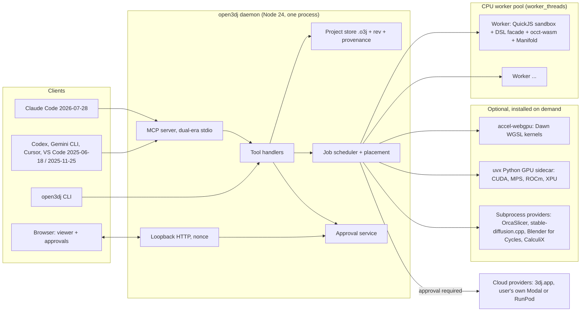

# Open3DJ architecture

Status: architecture of record from 28 Oct 2026, paired with [PLAN.md](PLAN.md). Step numbers (S0 to S12) refer to the plan's roadmap. Detail lives in [ASSEMBLIES.md](ASSEMBLIES.md) (document model and solving), [COMPUTE.md](COMPUTE.md) (CPU and GPU compute) and [INDUSTRIAL-DESIGN.md](INDUSTRIAL-DESIGN.md) (the product design pipeline). Evidence for each choice is in [research/](research/), mainly [research/lean-stack.md](research/lean-stack.md), [research/assemblies.md](research/assemblies.md), [research/compute-cpu-gpu.md](research/compute-cpu-gpu.md) and [research/industrial-design.md](research/industrial-design.md). The superseded funded-team design is in [research/archive/full-scale-architecture.md](research/archive/full-scale-architecture.md); this document reuses its good ideas and drops its day-one Rust and native-kernel build. `open3dj` and `@open3dj` are working placeholders; nothing is reserved or published under them until founder decision 1 ([PLAN.md](PLAN.md) section 11).

## 1. Principles

1. **The feedback loop is the product.** Every change returns a GeometryReport, reference states, gate results and, on request, a deterministic picture.
2. **Every design is an assembly.** A single part is a root assembly with one occurrence. There is no part-only code path.
3. **The CPU decides, the GPU accelerates.** The B-rep geometry of record, report numbers and gate verdicts come from the deterministic CPU kernel. GPU paths screen, display, render and generate, and every one has a declared CPU placement: a CPU twin, or a slower CPU backend for generation.
4. **Contracts are fixed; implementations swap on measured triggers.** Nothing is rewritten; parts behind a contract are replaced.
5. **Humans own consent.** Approvals belong to the daemon, never to an MCP message.
6. **Zero native builds and near-zero cash** until a measured trigger or a desktop binary says otherwise. Open3DJ compiles no native code. Native tools it drives as subprocesses (OrcaSlicer, Blender for Cycles renders, stable-diffusion.cpp, CalculiX) come from their projects' official binaries, a package manager or the user's own install; a platform with none gets a structured error naming the missing tool, never a build job. Platform coverage per tool is listed where the tool is introduced (to verify for CalculiX and stable-diffusion.cpp). Every small cash item and its free alternative is listed in [PLAN.md](PLAN.md) section 11.

## 2. Fixed contracts

These are versioned in `packages/schemas/`. A breaking change needs an RFC, a major version bump and an agent-written migration that runs over every project, library part and bench task in the repo. An additive (minor) change, such as a new op, field, view, format, job kind or DSL entry, needs a minor version bump and a changelog line, but no RFC.

| # | Contract | Content | First version |
|---|---|---|---|
| C1 | Tool and report schemas | The five MCP tools, GeometryReport, references, Evidence Pack and waivers, jobs, approvals, provenance | S0 |
| C2 | DSL v1 | The 3dj-compatible modelling surface and its tolerance-based conformance suite | S1 |
| C3 | `KernelAdapter` | Synchronous, opaque-handle kernel interface, vendored from brepjs and coded against occt-wasm facade semantics | S0 |
| C4 | `.o3j` project | Assembly graph, scripts, params, brief, CMF, evidence, provenance and replay | S0 |
| C5 | Compute contract | Job kinds, `runsOn` backends, determinism, privacy, `inputsHash`, DeviceInventory, and `backend`, `device`, `placement_reason` in every result | S0 |
| C6 | Library Convention manifest | Standard part metadata: cited standard, units, tolerances, licence, connectors, BOM fields | S4 |
| C7 | Bench task schema | Brief, executable assertions, reference solution, seeded mutant, split | S0 |

## 3. Components and process model



**Processes.**

- **Daemon.** One Node process started by `npx -y open3dj mcp` (stdio) or `open3dj serve` (loopback HTTP for the viewer; in S2 the viewer is served by `open3dj view`, one process per watched script). It owns the project store, revisions, the scheduler and approvals. It never loads the kernel, because the occt-wasm STEP writer prints to stdout and would corrupt MCP stdio.
- **CPU workers.** `worker_threads` managed by a small own pool, created with `stdout: true` and `stderr: true` so kernel output goes to the log, never to MCP stdout (piscina 5.3.2 cannot pass these options; [COMPUTE.md](COMPUTE.md) section 4). Each worker holds one single-threaded occt-wasm instance, Manifold and a QuickJS-WASM runtime. Workers are recycled at 1.5 GiB of WASM memory plus JS heap (Node's `resourceLimits` do not cover WASM memory), after N jobs or on any kernel error. During a job, a guard on `WebAssembly.Memory.prototype.grow` in each worker refuses growth past 2 GiB and tells the pool, which ends the job with JOB_MEMORY and replaces the worker; the JS heap has a 1 GiB old-generation limit. Export meshes use a chord of 0.1 mm or 1e-4 of the largest part diagonal, whichever is larger, so very large parts cannot produce unbounded meshes. Node's permission model applies to the whole process, not to one worker thread, so it cannot give a worker a stricter policy than the daemon, which must write project files (a per-thread policy is to verify); it fences the kernel only once workers move to a child process started with `--permission`. [research/spikes/mcp-worker.md](research/spikes/mcp-worker.md) recommends child processes as the only production backend, because only a child kept file-descriptor-level stdout writes from a `node:vm` escape off the MCP wire, and thread-backend main RSS rose from 160 to 331 MB over 18 restarts before levelling off; Open3DJ runs scripts in QuickJS-WASM, which gives them no file-descriptor access, so worker threads with captured stdout plus print hooks are the S1 choice, and the swap to child processes ([COMPUTE.md](COMPUTE.md) section 4) applies after a sandbox finding or with a native kernel.
- **Optional accelerators.** `@open3dj/accel-webgpu` loads Dawn in a dedicated worker (S7a). The Python sidecar is a `uvx` subprocess speaking the same job spec over stdio (S8a). GPL and AGPL tools run only as subprocesses. Every subprocess is spawned with piped stdout and stderr, so nothing it prints reaches MCP stdout.
- **Browser.** The viewer and approval page are a plain web app served by the daemon on `127.0.0.1` with a per-session nonce (S2, S5). A later desktop shell hosts the same app.

**Request path.** A tool call arrives, the handler checks `base_rev`, writes a job, and the scheduler places it on a worker. The worker runs the script in QuickJS, calls the DSL facade, which calls the `KernelAdapter`, and returns the shape handles' report data. The daemon assembles the GeometryReport, appends provenance and returns the result (or a `job_id` for long work).

## 4. Kernel strategy

**Today.** brepjs 20.11.1 on occt-wasm 5.8.1 (OCCT 8.0.1, wasm32, SIMD, no pthreads, relaxed-SIMD left out for reproducibility). Measured at 1.23x to 2.12x of native, 121 ms start, and structured errors instead of segfaults ([research/lean-stack.md](research/lean-stack.md), [research/spike-occt-wasm.md](research/spike-occt-wasm.md)).

**The seam.** The `KernelAdapter` (C3) is synchronous with opaque handles. Open3DJ codes it against the occt-wasm facade (about 230 functions with u32 handles), not against brepjs internals. brepjs is a replaceable convenience: its instancing, joint transforms, FK and URDF export are reused; its mate solver, `mechanismDOF` and `checkInterference` are never used for reports, because the spike showed a silently ignored conflicting mate, 4 DOF for a four-bar of mobility 1, and touching treated as a hit ([research/assemblies.md](research/assemblies.md)).

**Hygiene.** Exact pins; mirrors of occt-wasm and brepjs; a reproducible occt-wasm build; a weekly upgrade batch that merges only if conformance passes, the bench regresses 10% or less and a 10,000-op soak shows no heap growth. `occt-wasm.wasm` stays a separate LGPL-2.1 file. Known OCCT 8.0.1 regression: guided and binormal sweeps give wrong volumes (OCCT #1681, no fix merged; [research/gap-3.md](research/gap-3.md)). Until it is fixed, a seeded regression test checks their expected volume and those sweep modes return a structured warning.

**Evolution without rewrites.**

| Trigger | Swap | What stays |
|---|---|---|
| A part exceeds 4 GiB, or p95 `run` over 2 s | Contribute a memory64 occt-wasm build; then compile the same C++ facade as an N-API addon (optionally with OCCT's parallel flags) | `KernelAdapter`, DSL, schemas, `.o3j` |
| A single binary that Node SEA cannot provide | Rust host running the same WASM through the occt-wasm crate on wasmtime | Kernel, DSL, schemas |
| Bench ablation puts the JS DSL 5 or more points behind build123d (measured quarterly through the external build123d-mcp server, [PLAN.md](PLAN.md) section 7) | Optional `uvx` build123d 0.13.0 worker tier (no Windows ARM64) returning the same report | Tools, reports, `.o3j` |
| Loop solving beyond the own LM solver | OndselSolver (LGPL-2.1) as a separate WASM module | Mate schema |

Every swap keeps the stdout rule from section 3: kernel output never reaches MCP stdout. A native N-API kernel runs in child processes with redirected stdout, not in worker threads, because native code writes to file descriptor 1 directly and bypasses a worker's captured `stdout` stream. A threaded WASM build likewise runs in captured workers or child processes, never in the daemon process.

## 5. Assembly-first document model (summary)

Full model, solving tiers and staging: [ASSEMBLIES.md](ASSEMBLIES.md).

- **Structure is data, geometry is script.** `assembly.o3j.json` holds the graph; `parts/*.o3j.js` holds one DSL script per part definition.
- **Definitions:** part script, library standard part with parameters, sub-assembly, or imported STEP (geometry stored in the project, references by fingerprint only); each unique configuration is its own definition; mirrored parts are handed definitions.
- **Occurrences:** UUIDv7 id, name, path address (`enclosure/pcb_assy/standoff#2`), definition plus configuration, transform as translation plus unit quaternion, suppressed and BOM flags, colour override. Euler angles exist only at the occt-wasm XCAF boundary (measured R = Rz·Rx for X and Z; Y to verify).
- **Connectors:** frames (origin, Z, X) anchored to named references, with 3dj gender and type tags. They inherit the five-state reference report.
- **Mates:** type, two connector paths, offset, limits, flip flags, a value bound to a `Param`, and a derived status.
- **Patterns, groups, explode states and motion studies.**
- **Always derived, never stored:** BOM, DOF, the clash, contact and clearance table, mass and centre of gravity.

**Solving tiers.** Closed form for fastened mates (S1 for script `matchTo`, S4 for agent-added mates) and tree joints (S6), with any extra mate checked at the closed-form pose and reported as redundant or conflicting, except a cycle-closing joint with free motion, which is `loop_unsolved` until S11 (mate statuses: [ASSEMBLIES.md](ASSEMBLIES.md) section 4.4); own Levenberg-Marquardt with DOF = 6n - rank(J), naming redundant and conflicting mates (S11); OndselSolver only on a trigger.

**Fits.** Three outcomes (clash, contact, clearance) checked in tiers: AABB filter (10,440 pairs to 144 in 5.5 ms), Manifold mesh volume and gap labelled "observed" (5.4 ms a pair, from S3), exact OCCT labelled "measured" (19 to 29 ms a pair, from S1). Mated contacts are exempt; press fits are declared.

**3dj mapping.** Named descriptor returns become definitions plus occurrences; identical clones become a shared definition labelled "measured" (from clone provenance) or "inferred" (from a geometry hash); `connector.male/female` become connectors; `matchTo` becomes a script-owned fastened mate re-derived on every run; `withReferences` become named references; `attachTo` becomes a fastened mate on an implicit connector (`anchor: implicit`). Detail: [ASSEMBLIES.md](ASSEMBLIES.md) section 3.

**Growth.** S1 definitions, occurrences, sub-assemblies, connectors, `matchTo` mates, exact fits, multi-part exports; S2 viewer tree and instancing; S3 observed fit tier; S4 fastened mates, declared fits, Replicate, configurations, BOM, named DOF, exploded steps; S6 tree joints, motion samples, swept clash; S7a GPU fit pre-check behind a CPU twin; S11 loops. Large-assembly mode and in-context design wait on the pull board.

## 6. Compute-device layer (summary)

Full design: [COMPUTE.md](COMPUTE.md).

**Discovery.** `open3dj doctor` builds a DeviceInventory at startup: CPU cores, architecture and RAM; GPU vendor, model and VRAM (systeminformation); WebGPU adapter info and limits when the accelerator pack is present; CUDA, MPS, ROCm or XPU from the sidecar; configured cloud providers; power state. It is recorded in provenance and the Evidence Pack. `doctor --bench` adds kernel micro-benchmarks, worker scaling, a viewer frame-time probe and a WebGPU probe.

**Job kinds declare where they can run.**

| Job kind | CPU | Local GPU | Cloud | Step |
|---|---|---|---|---|
| Script run, booleans, fillets, STEP | occt-wasm pool | none (OCCT is CPU-only) | none | S1 |
| Exact fits | occt-wasm | none | none | S1 |
| Fit pre-check (broad phase, mesh fit tier), wall and overhang maps | AABB filter, Manifold, three-mesh-bvh rays in workers | WGSL broad phase and ray casts (accel pack); may only drop pairs beyond the watch distance plus a guard band | none | S1, S3, S7a |
| Viewer display, picking, zebra and draft shading | HLR image view when no GPU context exists | three.js WebGPU, WebGL2 fallback | none | S2, S9 |
| Variants, sweeps, swept clash | batch lane | none | none | S4, S6 |
| SDF and lattice fields | Manifold LevelSet (record) | WGSL preview | none | S7a |
| Concept images (`gen.image`) | `cpu.sdcpp`: stable-diffusion.cpp (MIT) with quantised GGUF weights of the same models; slow, output is a `preview` | Python sidecar | user's provider, with approval | S8a |
| Image-to-3D massing (`gen.massing`) | the agent builds the massing in the DSL from the approved board on the pool, labelled "assumed"; candidate mesh backend: TripoSR (MIT) in the sidecar on the CPU, after a four-layer licence audit (to verify); a structured refusal only when the user insists on a generated mesh and no local backend is cleared | Python sidecar, CUDA (TRELLIS v1; upstream minimum a 16 GB card) | 3dj.app (text, or an image at a public URL) or user's provider, with approval | S8b |
| Photoreal and CMF renders | Cycles CPU, inside Blender run as `blender -b` | Cycles CUDA, OptiX, HIP, oneAPI, Metal (same Blender) | optional | S9 |
| FEA | CalculiX subprocess | Warp FEM, PETSc (pull board) | provider | S11 |

Every job kind has a CPU placement; a new kind without one needs an A3 that says why.

**Calls and results.** Agents see devices with `inspect fields=[devices]`. Heavy tool calls take `compute: "auto" | "cpu" | "gpu" | "cloud"`. `auto` falls back to the CPU and records why. An explicit `gpu` with no capable device returns a structured error. Every result carries `compute: {backend, device, placement_reason}`, plus `fallback_from`, `cpu_confirmed` and `screened_by` where they apply.

**Placement rule.** Filter by capability, licence and privacy; drop devices without the memory. For a model job (sidecar or subprocess) whose pack declares a measured peak VRAM, the peak must fit within 90% of free VRAM (proposed); for daemon WGSL and viewer work, which shares the GPU with the display, and for any job without a declared peak, the estimate must stay within 42% of reported VRAM (70% of a 60% budget). TRELLIS v1 therefore places locally on a 24 GB or larger card, on a 16 GB card only if its measured peak fits (to verify in S8b), and never on an 8 GB card ([COMPUTE.md](COMPUTE.md) section 3.3). Then pick the lowest estimated time from per-device profiles of past runs; break ties by cost, then local before cloud. A prediction more than 2x off is logged as a defect. Cloud spend and egress always need a daemon-owned approval.

**CPU pool.** Own pool with captured worker stdout; one kernel per worker; size `min(cores - 1, floor(freeRAM x 0.7 / recycle limit))`, so workers that grow to the recycle limit cannot over-commit RAM; an interactive lane with one reserved worker and a batch lane; recycling at 1.5 GiB (proposed; peak worker memory is an S0 measurement in `doctor --bench`). Assemblies parallelise naturally by definition, clash pair and variant. Scaling is measured, not assumed: the spike gave 1.67x with 4 workers on a contended 4-vCPU container ([research/spike-occt-wasm.md](research/spike-occt-wasm.md)); S0 re-runs it on an idle machine. A 4-core machine has only 2 batch workers.

**GPU rules.** "GPU screens, CPU decides": GPU values are "observed". A GPU value never decides a verdict inside the guard band of a threshold, and never fails or passes a sample without a measured bound: the GPU may clear a sample only if its kernel used exactly the CPU twin's sample set (same rays and tessellation) and the guard band exceeds the largest GPU-CPU deviation measured for that adapter and driver by a stated safety factor. The bound is calibrated per adapter and driver on a fixed calibration set at first use and stored in the device profile. It is empirical, not a proof for new geometry, so a verdict that rests on GPU-cleared samples is a `preview`, carries a `screened_by` field (for example `webgpu.d3d12`) and keeps one of the four confidence labels. Every verdict of record is CPU-decided: design freeze, export gates and RFQ packs (all `record` requests) recompute the GPU-cleared samples on the CPU twin. The nightly full CPU-twin recompute on the corpus is the gauge, and a verdict of record that rests on GPU output is a red andon. A WGSL kernel merges only with a CPU twin, a fixed-seed tolerance test, a lavapipe CI job and at least a 3x gain on a real GPU. On device loss, out-of-memory or a TDR reset the job re-queues on the CPU twin. Dispatches are tiled to about 50 to 100 ms, storage bindings stay within 128 MiB and VRAM estimates within the placement limit above. On battery or thermal pressure the pool halves, the GPU uses `low-power`, batch GPU jobs wait and the job status tells the agent.

## 7. The DSL and the sandbox

**DSL v1.** An Open3DJ-owned facade over the about 150 entries of the 3dj DSL: `Param.*`, primitives, sketches, booleans (batched: `fuseAll` took 0.7 s where 200 sequential fuses took 17.5 s), fillet and chamfer with edge queries, shell, patterns, named references (`withReferences`, `attachTo`, `onFace`, `hole`), `lib.*` standard parts, connectors with `matchTo`, DfAM helpers and measurement. Native scripts may also call `asm.part()` and `asm.place()`. DSL v1 also covers the calls the starters make beyond the documented entries: `.color()`, `.name()`, `lib.bolt`, `lib.nut`, `lib.washer` and `.cutPlane(plane, offset, keep)` ([research/gap-2.md](research/gap-2.md)). Later ops (`draft`, `fill`, `gordon`, `lattice`) arrive with their steps. The facade extracts solids where the kernel returns compounds (for example after `cutAll`).

**Conformance.** The 18 public 3dj starters run through both engines. 3dj.app runs OpenCascade.js 7.7.2 and Open3DJ runs OCCT 8.0.1, so conformance is tolerance-based ([research/gap-2.md](research/gap-2.md)). The gate is volume, area, bounding box and surface deviation, within relative tiers of 1e-6 without blends and 1e-4 with fillets and lofts (proposed; to verify). Topology counts are warnings only, because seam edges and fillet face splits can differ between OCCT major versions. `cad_validate_script` is static only, so S0 captures golden STEP files and measures for the 18 starters once from the 3dj workbench into `corpora/`.

**Sandbox.** Agent scripts run only in QuickJS-WASM (quickjs-emscripten 0.32.0). The limits are: a hard memory cap from a fresh QuickJS instance per run with a capped `WebAssembly.Memory` (128 MiB in the spike), because `setMemoryLimit` alone bounds only single allocations (upstream issue #271; under a 64 MiB limit the runtime used about 1.4 GB); a best-effort interrupt deadline, which does not fire inside kernel calls and overshot 16x to 42x on slow builtins; and a parent wall-clock watchdog, which is the real CPU bound ([research/spikes/sandbox.md](research/spikes/sandbox.md)). The timeout is sticky: an interrupt that lands inside an async function only rejects its promise, so once the deadline passes the run refuses further host calls, drops the guest's memory limit to nothing (every later call fails at once, so the next interrupt check ends the loop that swallowed the first), and ends with SCRIPT_TIMEOUT even when the script returns normally. The first spike showed no `process`, `require` or `fetch`, the `constructor.constructor` escape closed, and a native `Array.fill` running 12 s past a 500 ms deadline, which is why the watchdog exists ([research/lean-stack.md](research/lean-stack.md)). Bridge overhead is about 1% on 100 sequential cuts ([research/lean-stack.md](research/lean-stack.md)) and about 7 to 15% on realistic parts (an enclosure and a 100-hole plate), mostly a fixed 4.5 ms setup per run ([research/spikes/sandbox.md](research/spikes/sandbox.md)). **QuickJS-WASM is the security boundary.** Node's permission model is defence in depth only, and only for a process started with `--permission` (section 3): no file writes outside granted paths, no child processes or addons; network is NOT restricted by Node 22's permission model, measured in [research/spikes/sandbox.md](research/spikes/sandbox.md) (Node 24 to verify). Node's own docs say the permission model does not protect against malicious code.

## 8. Native format, provenance and replay

```
enclosure.o3j/
  project.o3j.json     schema version, units (mm), Z-up, engine pins
  assembly.o3j.json    assembly graph (C4)
  parts/*.o3j.js       DSL scripts, one per part definition (or one named export each)
  parts/*.step         imported STEP definitions
  params.o3j.json      typed parameters shared by scripts and mates
  brief.o3j.yaml       brief with executable assertions (S5)
  cmf.o3j.json         colour, material, finish per occurrence (S9)
  evidence.json        Evidence Pack for the current revision
  approvals/           approval records with payload hashes (S5)
  prototypes/          photos and measured readings (S5)
  concepts/            concept boards and massing meshes, labelled (S8a, S8b)
  rfq/                 RFQ packs built from a design freeze (S12)
  provenance.jsonl     append-only: call, args hash, result hash, engine pins, device
  .o3j-cache/          content-addressed tessellation per definition (git-ignored)
```

What S1 writes today (packages/mcp/src/store.ts): `project.o3j.json`, `main.o3j.js` (the one script of the project; `parts/*.o3j.js` and `parts/*.step` come later), `params.o3j.json`, `assembly.o3j.json`, `evidence.json` and `provenance.jsonl`, plus:

```
  revisions/r_0001.json  immutable record per revision: script, params, inputs hash, engine, graph, report
  out/r_0001/            renders and exports of that revision, with evidence sidecars (git-ignored)
  .o3j-cache/            detailed reports for inspect (git-ignored)
```

A run with the same script and parameters keeps the head revision, but only when the head was made by the same engine versions and the same analysis version (`ANALYSIS_VERSION` in `@open3dj/schemas`, recorded in each revision as `analysis` and bumped whenever fit, reference or report code changes what a report says). A head without it, or with an older one, is rebuilt. A failed run creates none. Commits take the project's `.o3j-lock` file (created with O_EXCL, taken over after 30 s) around the head check and the write, and a revision file is created with link(), which never replaces an existing one, so two processes on one project (two daemons, or the CLI next to a daemon) cannot claim the same revision. Reads, like writes, refuse a symlink anywhere below the project folder. A project folder may come from a clone or a download, so the store treats its contents as untrusted: a revision record must match the assembly schema and expand to at most 100,000 occurrences in at most 32 levels (counted per definition, without expanding the graph), or it is PROJECT_CORRUPT; only regular files named r_ with at most 7 digits count as revisions; something other than a file at `.o3j-lock` is PROJECT_CORRUPT with a hint, not a 15 s wait; and `export` refuses an `out_dir` inside the store's own entries (revisions, .o3j-cache, .o3j-lock and the project files). Parameter values passed to `run` are saved in `params.o3j.json` as the working copy, after the script resolved them: only the names the script declares, clamped to their min and max. They belong to the working script: a run of the same script (or ops alone) uses them, and a run with a different script starts from that script's defaults plus the params of that call, with a report warning that names the stored values it did not use. That warning is stored in the new revision's report (status `warning`), so `open3dj view`, `inspect` and later reads show it too. A script that differs only in `//` comments, blank lines or trailing spaces counts as the same script and keeps the stored values (`sameCode` in packages/mcp/src/handlers.ts). Only values the new script declares and resolved differently are named: an edit that leaves a param's value as it was does not warn. `run` with `save_params: false` (CLI `--no-save-params`) records the values in the new revision but leaves `params.o3j.json` as it was, and the CLI prints `saved params: ...` whenever a run changes that file. Each export folder holds one evidence sidecar per revision (`<name>.evidence.json`): every export into it adds its files, and an earlier entry stays only while its file is on disk with the recorded sha256. STEP headers carry the file name, the revision's time in UTC as the time stamp, `Open3DJ <version>` as preprocessor and originating system, and the manifest's optional `author` and `organization` (empty strings when unset).

- **Revisions.** Every accepted change creates a revision id; tools take `base_rev` and refuse stale writes. State is never keyed on MCP sessions, because legacy sessions exist and modern ones do not ([research/gap-6.md](research/gap-6.md)).
- **Provenance.** Each line records the tool call, argument hash, result hash, engine and dependency pins, DeviceInventory hash, backend and device, and approvals referenced.
- **Replay.** `open3dj replay` re-runs a project's provenance. Across platforms, measures must agree within tolerance; GPU artefacts compare by tolerance. Same-platform hash equality is hypothesis **H-det**, not yet a requirement. On native OCCT, PR #1600's pointer-keyed maps in `BRepOffset_MakeOffset` let one input succeed in only 11 of 20 fresh processes ([research/gap-8.md](research/gap-8.md)). On occt-wasm, a single spike that has not been reproduced yet ([research/spikes/endurance.md](research/spikes/endurance.md), occt-wasm 5.8.1 on Linux x64) found 5 fresh processes and 3 fresh kernel instances bit-identical for its whole corpus, including shell and offset, because WebAssembly has no address-space randomisation; reusing a warm instance broke bit-identity for offset and shell (7 to 17 distinct volume bit patterns; mesh, STL and STEP differed on every repeat). S0 re-runs H-det on every tier-1 OS before the DSL facade exists, with 20 fresh processes and 20 warm reuses on the 3 starters that the S0 facade spike runs plus a shell and offset corpus written as raw occt-wasm scripts ([PLAN.md](PLAN.md) S0). If it fails, the fallbacks in order are: run record requests (goldens, evidence hashes, replay) on a fresh kernel instance (about 30 ms with a shared compiled Module); carry the PR #1600 or libcascade patch through an occt-wasm contribution; or compare measures by tolerance for the affected ops. The first run, on Linux x64 through the DSL facade (`scripts/hdet.ts`, [ops/build-log.md](../ops/build-log.md)), found measures bit-identical in fresh and warm runs, and STEP bytes identical across fresh processes but not on a warm worker: usage ids came from a counter that lives as long as the kernel, and colour entities came out in another order after other jobs.
- **Decided fallback for STEP (founder, 2026-10-28).** The first fallback, for STEP. (1) A job that exports STEP runs on a fresh kernel instance: the job runner calls `kernel.fresh()` (packages/compute/src/job.ts), which instantiates the thread's compiled WebAssembly module with the same print sink, runs the whole job there and disposes the instance; the worker's warm kernel is not touched. Any other record request (replay, golden checks) sets `freshKernel: true` on its job to get the same. A fresh instance costs a median of 25 ms; a STEP export job got 22 ms (bracket) to 82 ms (enclosure) slower on a warm worker (median of 10). (2) The STEP exporter renumbers `NEXT_ASSEMBLY_USAGE_OCCURRENCE` ids '1', '2', ... in file order (`renumberUsageIds`, packages/assembly/src/export/step.ts), so plain exports outside the job runner are stable in their ids too. (3) An export of a stored revision writes the revision's time (UTC, to the second) as the FILE_NAME time stamp instead of the wall clock (`ExportOptions.timestamp`), so exporting the same revision again gives the same bytes. Measures, STL, glTF and 3MF keep running on the warm kernel. The other tier-1 OSes still need the H-det run in CI.
- **Git-friendly.** Everything except the cache is text, so a project is reviewable as a PR.

## 9. Agent tool surface

Five tools, all working over plain `tools/list` and `tools/call` at 2025-06-18. A sixth needs an A3 showing a bench gain. This section is the single canonical C1 tool list: [ASSEMBLIES.md](ASSEMBLIES.md), [COMPUTE.md](COMPUTE.md) and [INDUSTRIAL-DESIGN.md](INDUSTRIAL-DESIGN.md) use these inputs and point here.

| Tool | Input sketch | Output sketch | Grows by |
|---|---|---|---|
| `run` | `{project, base_rev, script? \| ops?[], candidates?[], sweep?, compute?, provider?}`; ops in the table below | `{status, rev, report}`, `{job_id}` or `approval_pending{url, id}` | ops by step, below |
| `inspect` | `{project?, rev?, fields[]: tree \| refs \| gates \| fits \| dof \| bom \| measure \| maps \| continuity \| assertions \| quotes \| tolerances \| sim \| job \| approval \| devices \| selection, maps?[]: wall \| overhang \| draft \| undercut, pull?: [x, y, z], gates?: profile id, job_id?, approval_id?, compute?, provider?}` (`devices` needs no project) | requested fields, concise or detailed | tree, refs, fits, measure, devices, job (S1); selection (S2: what the person selected in the viewer); gates, maps (S3); dof, bom (S4); assertions, quotes, approval (S5); maps on the GPU (S7a); continuity, maps=[draft] (S9); maps=[undercut] (S10); tolerances, sim (S11) |
| `render` | `{project, rev?, view: multiview \| section \| highlight \| exploded \| motion \| board \| zebra \| curvature \| map \| cmf, targets?[], note?, compute?, provider?}` | PNG or SVG, deterministic on CPU (`cmf` is a Cycles render, display only); `highlight` draws nothing and points the running viewer at the targets | highlight (S2), exploded (S4), motion (S6), board (S8a), zebra, curvature, map and cmf (S9) |
| `export` | `{project, rev, format: step \| 3mf \| gltf \| stl \| bom \| urdf \| plates \| quote \| mjcf \| drawing \| ap242 \| rfq, scope?: root \| sub-assembly path \| occurrence path, gates?, compute?, provider?}` | file paths plus evidence sidecar, or `approval_pending{url, id}` | bom (S4), plates and quote (S5), urdf (S6), mjcf (S11), drawing, ap242 and rfq (S12) |
| `docs` | `{query, page?}` | paged hits from the DSL reference, `lib` parts, the error playbook and examples | none |

**`run` ops by step:**

| Step | Ops |
|---|---|
| S1 | `set_param`, `cancel_job` (with the minimal job model) |
| S2 | `add_occurrence`, `remove`, `set_transform`, `replace_definition` (moved from S1: in S1 the script places every part, and the published run schema lists only the S1 ops) |
| S3 | `waive` |
| S4 | `add_mate`, `set_mate`, `declare_fit`, `pattern`, `explode`, `set_bom` |
| S5 | `set_brief`, `request_approval`, `record_prototype` |
| S6 | `set_joint` |
| S7a | DSL entry `lattice` (field meshed on the CPU by Manifold LevelSet; WGSL preview) |
| S8a | `generate` with `gen.image` |
| S8b | `generate` with `gen.massing` |
| S9 | `set_cmf`; DSL entries `fill`, `gordon` |
| S10 | DSL entry `draft` |

**Concise report** (300 tokens or fewer by default):

```json
{"status":"ok","rev":"r_0193..","assembly":{"occurrences":9,"definitions":5,"mass_g":61.4},
 "parts":[{"def":"base","valid":true,
   "gates":{"fail":[{"gate":"min_wall","value":0.7,"limit":0.8,"at":"@elem:op_4:side:2","waivable":"agent"}]}}],
 "fits":[{"a":"lid#1","b":"screw#3","kind":"clash","volume_mm3":14.7,"confidence":"measured"}],
 "refs":[{"name":"pcb_seat","state":"exact"}],
 "compute":{"backend":"cpu.wasm","device":"cpu x7","placement_reason":"auto: no gpu backend for kind"},
 "next":["render view=highlight targets=[lid#1,screw#3]"]}
```

In S1 a run result carries `status`, `rev` and `compute` once, next to the report, and the concise report leaves out per-part area, centre of mass and face and edge counts (`detail: "detailed"` and `inspect` give them). Identical fits collapse into one line with `n`, for example `{"a":"base","b":"screw#1..4","kind":"clearance","distance_mm":0.5,"n":4}`; each distinct gap of a pair is its own line ([ASSEMBLIES.md](ASSEMBLIES.md) section 6). The concise report is trimmed to a budget rather than to fixed counts, so it holds whatever the assembly contains. Entries are ranked (invalid parts and parts in a clash first; clashes, then contacts, then clearances, with each pair's further gaps (`extra`) last; broken and ambiguous refs first), and one step at a time it drops render targets from `next`, then the lowest-ranked refs, parts, warnings and fits down to one each (fits last, because they are what an assembly report is for), then shortens names (64 characters, halved down to 16), then drops the standing notes, and finally the last warning, ref, fit and part, until the run result is 1000 characters or fewer (about 250 tokens at 4 characters a token). Every list that lost entries says how many in a closing note, with the call that shows them. Warnings are cut to 160 characters; a ref's reason is cut in the middle, so its ending (which candidate is the query's pick) stays. The CLI prints the report to a person, who has no token budget: when the concise report left fits or definitions out, `open3dj run` reads them back with `inspect` and lists every collapsed line. packages/mcp/src/report-budget.test.ts holds examples/enclosure, 10 long-named parts that all clash, 12 long warnings, and 30 parts with 120-character names, 29 distinct clashes and 60 named faces to 1000 characters.

Errors are tool results, not protocol errors: script line and column (the first character of the failing call, also inside a `return` statement or a call chain), kernel error code, faulty sub-shapes with element addresses, and a suggested fix. `inspect` adds a prefilled failure-report link (never an automatic post).

**CLI parity.** `npx open3dj <tool> ...` calls the same handlers. One CI test checks that the CLI schema dump equals `tools/list`. There are no generated SDKs until an integrator asks. CLI exit codes: 0 ok (warnings included), 1 a part is invalid (report status error), 2 script, kernel or tool error, 3 usage error.

**Dual-era MCP.** `@modelcontextprotocol/server` 2.4.0 `serveStdio` answers 2026-07-28 discovery for Claude Code and `initialize` for clients at 2025-06-18 and 2025-11-25. Client compatibility is checked in two layers, because GUI clients and clients that need an account or API key cannot run on free hosted runners, and forks get no secrets:

- **CI client matrix** (every PR, all tier-1 runners, no secrets, so forks run it too). Scripted clients built on the official MCP SDKs open a session at each era (2025-06-18, 2025-11-25 and 2026-07-28), then run `tools/list` and one `tools/call` per tool on a fixture project. The 2025-06-18 client is the `@modelcontextprotocol/sdk` 1.23.0 client that Gemini CLI pins ([research/gap-6.md](research/gap-6.md)); the SDK versions for the other two eras are pinned when S1 starts (to verify). CI also replays the opening handshake recorded from each named client against the server, from fixtures scrubbed of local paths.
- **Manual client checklist** (the founder's machine). A live smoke run of Claude Code (default and `MCP_PROTOCOL_NEGOTIATION=legacy`), Codex (default, and with the `mcp_2026_07_28` feature on plus `CODEX_MCP_PROTOCOL_VERSION=2026-07-28`, which stdio servers need), Gemini CLI, Cursor and VS Code: connect, `tools/list`, one `run` and one `export`. It runs before each release that changes `packages/mcp` or bumps the SDK, and at least once a month, and the result goes in the build log. When a client's handshake changes, its fixture is re-recorded in the same run.

Tasks (SEP-2663) and MCP Apps are optional layers once two or more major clients support them by default.

**Job model.** Long work returns `job_id`. Agents poll with `inspect fields=[job]` (state, progress, `attempts[]` with each placement tried, and for a finished run `result`: the output `run` would have returned, with the concise report or the error with its line and hint); progress notifications are sent where supported. Jobs carry the C5 fields and are cancelled with `run ops=[{op: "cancel_job", job_id}]`, which creates no revision ([COMPUTE.md](COMPUTE.md) section 9).

**The person and the agent on one project (S2).** `open3dj view` and `open3dj mcp` are separate processes that share only the project folder, so they meet in two small files under `.o3j-view/` (git-ignored, never part of a revision). When the person selects parts, faces or edges in the viewer, the page sends them to the view server, which checks every path and face number against the revision and stores `selection.json`: the occurrence path, the definition, the element address (`lid@elem:face:5`; edges have no address yet and are named by the faces they bound), the named reference and its kernel fingerprint when one resolves to that face, the observed area, centroid and normal from the display mesh, the revision and a time stamp. Agents read it with `inspect fields=[selection]`, which adds the head and `stale` when the head has moved on. In the other direction, `render view=highlight` with targets (occurrence paths, definitions or `<path>@elem:face:<n>`) and an optional note writes `highlight.json` without a kernel job (compact, within the 64 KiB the viewer reads back; a highlight that names more says `truncated`); the view server polls it, checks it, and sends it on the event stream, and the page fills those faces, tints parts named whole, shows hidden targets through the parts in front of them and says "pointed at in this project", with a dismiss button. It never moves the person's camera; the person frames the targets when they choose. Both files are untrusted on read, because any process of the same user, or a cloned project, can write them: schema first (`viewer-selection`, `viewer-highlight`), then the revision. The selection is rebuilt from the revision on every read (only the path, the face or edge numbers and the observed numbers come from the file; the definition, address, reference and fingerprint are made again, and items that do not check out are dropped). A highlight must carry a time that is not in the future, and each target must resolve on its revision to exactly its paths and face, so a target is a name from the design, never free text. A selection says what the person clicked, never what they approved.

**Approvals.** Human-only actions (human-only waivers; stage sign-offs for brief, directions (ideation), direction (concept 3D), form, CMF, ergonomics, tolerance scheme and drawings; the reading of a simulation (`sim_reading`); skipping a pipeline stage, with a reason (`stage_skip`); design freeze; quote acceptance; cloud spend; egress) create an approval object `pending -> approved | denied` with a payload hash. It is approved only on the nonce-protected local page (later the desktop app). Delivery: `approval_pending{url, id}` in the tool result for every client, plus URL-mode elicitation where the client supports it. An MCP elicitation `accept` is never consent, because Claude Code elicitation hooks can answer automatically. A WebAuthn user-verification step-up is spiked in S5 for high-stakes approvals.

## 10. Feedback signals

- **GeometryReport.** Per definition and for the whole assembly: validity, volume, bbox, mass, centre of mass, counts, fits, references, mate status of script `matchTo` mates, compute block and `next` hints (S1); later gates (S3), DOF and graph-owned mate status (S4), analysis maps (S3, S7a), continuity (S9) and tolerances (S11).
- **Five-state references.** `exact`, `re-resolved`, `disambiguated`, `ambiguous` (candidates, never auto-picked), `broken` (with reason). S1 resolves by geometric fingerprint (exact, ambiguous, broken); S3 adds occt-wasm history ops for re-resolution and disambiguation. In S1, `withReferences({ name: { face: query } | { edge: query } })` names one element by a query; the run stores its fingerprint (type, surface or curve, area or length, centroid, plane normal or axis or line direction, and the count of bounding edges or sharing faces) with the part definition in the assembly graph. The next run names the element again and compares: `exact` when the query picks one element and no other element of the same kind and orientation matches the stored fingerprint as well (a hole that moved is still exact when it is the only hole). The only element of its kind and orientation must still agree in two of size, adjacency and position, or lie on the same plane, axis or line; otherwise it is `ambiguous` with itself as the one candidate, so a removed bore never hands its name to a fillet. When the element had twins as it was named (the same kind, orientation, size and adjacency elsewhere, as in a pattern of identical holes), the fingerprint records their count, and only an element at the stored position or on the same plane, axis or line can keep the name: a hole that is counterbored, plugged or removed never hands its name to its twin, and a twin pattern that moves with a parameter is `ambiguous` with the query's pick as the first candidate. Fingerprints are compared in the frame the name was given in: the definition stores the rigid moves made after `withReferences` (`frame`), so moving or turning a whole part between revisions keeps its names `exact`; `ambiguous` with candidates when the query matches several elements, or other elements match the fingerprint as well or better than the query's pick; `broken` with a reason when the query matches nothing, or nothing of the stored kind and orientation is left. A name that is ambiguous or broken makes the report status `warning`. The concise report lists `refs[]` as name and state; `inspect fields=[refs]` adds the element address (`face:7`) and the fingerprint. Point references (`[x, y, z]`) are construction points and are not fingerprinted. A silent mis-resolution in the 1,000-edit sweep is a red andon.
- **Evidence gates.** Gate profiles are versioned data: `fdm.v1` (watertight, 0.8 mm wall, 45 degree overhang, 220 x 220 x 250 mm bed) in S3, `im.<resin>.v1` in S10. Each gate is either agent-waivable (with a recorded reason) or human-only (needs an approval). Every number carries a confidence label: measured, observed, inferred or assumed.
- **Renders.** occt-wasm HLR multiview PNG and SVG (135 ms for four views, byte-identical across processes) for agents and CI goldens; GPU shading only in the viewer.
- **Value stream.** Approval and provenance timestamps give stage lead time and rework loops per project; escapes and the few counts only a human knows are single-field entries on the approval page, prototype record or returned quote ([INDUSTRIAL-DESIGN.md](INDUSTRIAL-DESIGN.md) section 6) (S5).

## 11. Compute providers

All providers implement one job spec and declare a licence manifest (licence, territory, commercial use, model hash), shown before any download or call.

| Provider | Runs | Step |
|---|---|---|
| Local CPU pool | Everything of record | S1 |
| Local WebGPU (accel pack) | Analysis screening, field previews | S7a |
| Local Python sidecar (`uvx`) | FLUX.1 schnell or Qwen-Image (Apache-2.0) in S8a; TRELLIS v1 geometry-only clean runner in S8b | S8a, S8b |
| Subprocesses | OrcaSlicer (AGPL), stable-diffusion.cpp (MIT) for CPU concept images, Blender in background mode (`blender -b`, GPL) for Cycles renders, CalculiX and Elmer (GPL) | S5, S8a, S9, S11 |
| 3dj.app via its MCP server | Operator-reviewed quotes in S7b, once proposal P-1 ships; generation on the managed fleet in S8b: text-to-3D, and image-to-3D only from an image at a public HTTPS URL (publishing a local board there is its own egress approval) until P-1's upload ships; OpenSCAD compile only if OpenSCAD input is pulled ([PLAN.md](PLAN.md) sections 7 and 9) | S7b, S8b |
| User's own cloud (Modal, RunPod) | The same sidecar jobs | S8a |

**Licence gate.** Four layers ([research/gap-4.md](research/gap-4.md)): package metadata, LICENSE files of git-installed extensions, model card licences of every download target, and in-file headers. TRELLIS v1 runs geometry-only without nvdiffrast, Inria rasterisers, pymeshfix or igraph. TripoSG, TRELLIS.2 and Hunyuan3D are opt-in restricted packs only.

**How Cycles is distributed.** The Cycles repository publishes no release binaries; standalone Cycles must be built from source with CMake and, for NVIDIA GPUs, the CUDA Toolkit and OptiX SDK (https://github.com/blender/cycles, BUILDING.md, checked 28 Oct 2026). Building it for five tier-1 targets would break principle 6. Open3DJ instead drives the Cycles engine inside an official Blender build in background mode (`blender -b` with a scene script), as a GPL subprocess, from the user's own install or an on-demand download shown with its licence manifest first. Official Blender 5.2.3 LTS builds cover Windows x64, Windows ARM64, macOS arm64 and Linux x64, with the CUDA, OptiX, HIP, oneAPI and Metal backends prebuilt; there is no official Linux ARM64 or macOS x64 build (https://www.blender.org/download/, checked 28 Oct 2026). There, `render view=cmf` uses a distribution's Blender package if one is installed (to verify), or returns a structured error naming the missing renderer, and CMF review falls back to the viewer's glTF material variants. Blender binaries are GPL-3.0-or-later and the Cycles code inside them is Apache-2.0. The scene script uses Blender's Python API, so Blender's licence page asks that it be published under a GPL-compatible licence; MIT qualifies (https://www.blender.org/about/license/). This replaces the Python-sidecar placement in [research/compute-cpu-gpu.md](research/compute-cpu-gpu.md) R4: the `bpy` wheel would pin the sidecar to Python 3.13, has no Linux ARM64 wheel either (https://pypi.org/project/bpy/, 5.2.3, checked 28 Oct 2026), and would load GPL code into Open3DJ's own sidecar process.

## 12. Security model

Sized for a local, single-user, loopback tool.

| Threat | Control |
|---|---|
| Malicious or buggy agent script | QuickJS-WASM boundary with memory and time limits; parent wall-clock kill; worker recycling; `--permission` as a second fence (no network control) |
| Kernel crash or hang | WASM containment; structured errors; worker restart |
| Other local processes or web pages calling the daemon | stdio by default; HTTP bound to 127.0.0.1 only, with a per-session nonce and Origin checks. The nonce never goes on a command line: `open3dj view` opens the browser through a private redirect file (mode 0600, deleted on exit), because any local account can read a process's argv. Residual risk, to close before S5 makes the page write design data (the S2 selection write cannot change the design): the nonce stays in the URL, so it is in the browser's history, and a user who pastes the printed URL into a new browser process puts it in that process's argv. Planned fix: trade the URL nonce on the first hit for an HttpOnly, SameSite=Strict cookie and redirect to a path without it |
| A page or process writing through the viewer (S2) | The viewer's only write is `POST <nonce>/api/selection`, which shares the person's selection with agents and cannot change the design or create a revision. It needs the nonce, the loopback Host, an Origin equal to the page's own (a missing Origin is refused), `Sec-Fetch-Site: same-origin` when present, `Content-Type: application/json` (so a cross-site form cannot send it, and a cross-site fetch would need a CORS preflight that is never answered), a `Content-Length` of 16 KiB or less (no chunked bodies), and a token-bucket rate limit (20 requests, refilled at 5 a second); the body must match the `viewer-selection-input` schema, every path must be a part of a stored revision and every face number within the kernel's face count. The server fills in the definition, element address and fingerprint itself and writes only `.o3j-view/selection.json`. Every other method and route answers 405, and there are no CORS headers. The agent's highlight travels the other way through `.o3j-view/highlight.json`, checked against its schema, its time and the revision (every target resolved again) before the page sees it; its note is shown as text only, and the page labels it by where it comes from (a highlight file in this project), not as the agent's voice. Agents treat the selection as data, never as instructions, and `inspect` rebuilds it from the revision on every read |
| Agent forging human consent | Daemon-owned approvals with payload hashes; MCP accept is not consent; WebAuthn spike; residual risk (an agent with shell access as the same user) documented. The S2 viewer selection is not consent either: any process of the same user can write a valid `.o3j-view/selection.json` (one that names real parts and faces), so it says what was clicked, `inspect` says so in its note, and it must never feed an S5 approval |
| Data leaving the machine | Local-only default; no telemetry; every cloud call or upload is an egress approval |
| Supply chain | Exact pins, mirrors, npm trusted publishing with provenance, licence gate, weekly gated upgrades |
| Contributed library parts and bench tasks | Run in the same QuickJS sandbox; never auto-run shared code |

**Trigger:** an OS sandbox (bubblewrap, Seatbelt, AppContainer plus Job Object) wraps the unchanged worker before any non-loopback transport or remote mode, or after any sandbox finding. Detail: [research/security-sandboxing.md](research/security-sandboxing.md).

## 13. Viewer and desktop path

- **S2 status:** `open3dj view` serves the viewer below. Picking is a CPU ray cast that resolves to the occurrence plus `face:<n>`, the kernel's face number (the export keeps the kernel's face order; `packages/viewer/src/elements.test.ts` checks it against the kernel), or to an edge named by the two faces it bounds (the edge snap shrinks with the face's size on screen, so zoomed-out clicks keep the face), or, with a section on, to the cut part's cap; there are no `edge:<n>` addresses yet. The person's selection is shared with agents (`inspect fields=[selection]`) and agents point the viewer at targets with `render view=highlight` (section 9). The frame-time probe exists (`open3dj.probe(ms)` in the page, `npm run viewer:bench` for the table); the gate itself is still open, because it needs a GPU machine.
- **S2:** read-only viewer served by the daemon: three.js r186 WebGPURenderer with automatic WebGL2 fallback (WebGPU is missing on many Linux setups and behind a flag on Windows ARM64 Chromium), then the CPU HLR image view where no WebGL context exists (Chrome 139+ refuses the SwiftShader fallback by default), assembly tree, `InstancedMesh` per definition from the tessellation cache, GPU picking that yields element addresses.
- **S5:** approval panel, brief and design-freeze views; the exploded-step editor, which writes through `run` with `base_rev` and the page nonce. Until S5 the page never changes the design (its one write shares the selection, section 12) and exploded steps are edited by the agent.
- **S9:** zebra, curvature and draft shaders; CMF variants.
- **Pull board:** large-assembly mode with LOD and graphics-only loading from the mesh cache (BatchedMesh arrived in S2: the viewer uses it above 24 definition and colour groups; mirrored parts are handed definitions, which BatchedMesh needs).
- **Desktop:** only on measured demand. Electron 45 runs the Node daemon unchanged; Tauri 2.12 would need a Node SEA sidecar. The choice comes from installer size and frame-time data. Signing costs start here ([PLAN.md](PLAN.md) section 11).

## 14. Formats

| Format | Direction | Notes | Step |
|---|---|---|---|
| STEP AP214 | Out, in | XCAF, pure assembly root; names set explicitly on both definition and instance labels (in the spike, unnamed definitions came back as "ASSEMBLY" and "SOLID"); colours are written but did not read back on import, a known gap ([ASSEMBLIES.md](ASSEMBLIES.md) section 12) | S1 |
| 3MF | Out | Components and build items; `partnumber` from the definition's stored `partNumber` where set (S1), daemon-assigned numbers from S4; own writer or lib3mf 2.5 (WASM, BSD-2-Clause); per-part print plates in S5 | S1 |
| glTF 2.0 | Out | Own per-definition writer from the tessellation cache; `EXT_mesh_gpu_instancing` in S6; `KHR_materials_variants` in S9 | S1 |
| STL | Out | Per definition | S1 |
| SVG, PNG | Out | HLR renders; drawing sheets (SVG, PDF) in S12 | S1 |
| URDF, MJCF | Out | Robots and mechanisms (URDF has no loops) | S6, S11 |
| STEP AP242 with PMI | Out | Needs an occt-wasm facade contribution (today's writer emits AP214) | S12 |
| 3dj DSL scripts | In | Native | S1 |
| Meshes (STL, OBJ, GLB) | In | Massing reference, labelled assumed | S8b |

## 15. Plugin points for the industrial design pipeline

Stage by stage use of these plugin points is in [INDUSTRIAL-DESIGN.md](INDUSTRIAL-DESIGN.md).

Each plugin point is a registry keyed by name and version, using the C1 and C5 contracts, so the pipeline grows by adding providers rather than changing the core.

| Plugin point | Interface | First implementations | Step |
|---|---|---|---|
| Gate profile | Data file plus checker functions returning verdicts with confidence | `fdm.v1`, then `im.abs.v1`, `im.pc.v1`, `im.pp.v1`, `im.pa.v1` | S3, S10 |
| Analyser | Job kind with CPU twin, optional GPU kernel | wall thickness, overhang, draft, undercut, curvature, continuity | S3, S7a, S9, S10 |
| Surfacing op | DSL entry plus acceptance check | MakeFilling G1 and G2 (`G2Error`), Gordon (`IsApproximate`), `draft` | S9, S10 |
| Render provider | Job spec, scene from glTF plus `cmf.o3j.json` | HLR (built-in), Cycles through a `blender -b` subprocess (section 11) | S1, S9 |
| Generative provider | Job spec plus licence manifest | Image models via sidecar or stable-diffusion.cpp on the CPU; TRELLIS v1 via sidecar; TripoSR on the sidecar CPU after its licence audit (to verify); 3dj.app; user cloud | S8a, S8b |
| Simulation provider | Job spec, results labelled "simulation, not test" | CalculiX, Elmer; Warp FEM on the pull board | S11 |
| Drawing generator | HLR views plus critical dimensions from brief assertions | built-in | S12 |
| Quote provider | Request from a design freeze; human accepts | OrcaSlicer estimate in S5; 3dj.app quotes from S7b if P-1 ships; RFQ pack in S12 | S5, S7b, S12 |
| Library part | C6 manifest plus script plus connectors | ISO fasteners, heat-set inserts, standoffs | S4 |

## 16. Testing and evals

- **Two suites** ([PLAN.md](PLAN.md) section 4.3). The regression suite replays reference solutions and seeded corpora deterministically, with no LLM; it must stay at 100% and runs in `check` and nightly. In S0 it holds schema round-trips and contract tests; from S1, bench v0 adds 20 replay tasks: the 18 public 3dj starters plus 2 multi-part assembly variants. The capability suite is weekly agent runs of bench briefs, reported as pass^3. As built, bench v0 uses Open3DJ's own parts instead of the starters: 12 regression tasks (9 from `examples/`, 3 new parts) and 10 capability briefs ([bench/README.md](../bench/README.md) says why). `npm run check` runs task-lint on all 22 tasks and the regression split with 3 replays that must be identical.
- **Unit and property tests** per package, run by the one-command `check` (under 10 minutes).
- **DSL conformance** on the 18 3dj starters (C2), tolerance-based.
- **Contract tests:** schema round-trips; CLI schema equals `tools/list`; the CI client matrix at all three MCP eras (section 9). Live client runs are the manual checklist in section 9, not CI.
- **Seeded corpora** for gates, fits, mates, references and DFM: any false pass is a red andon. `corpora/reference-assemblies` (S0) holds the 145-occurrence plate, the 10 enclosure briefs, a generated assembly of 1,000 or more occurrences and dense wall-map parts; it is the timing corpus for S3 and S7a.
- **CPU and GPU parity:** every GPU kernel's fixed-seed tolerance test on lavapipe; nightly verdict comparison of `auto` against `cpu`.
- **Soak:** 10,000 operations without heap growth; the 1,000-edit reference sweep.
- **o3dj-bench.** Tasks under C7 with task-lint (the reference solution must pass and a seeded mutant must fail; in S0 reference solutions are checked against the 3dj workbench goldens, and from S1 they run through Open3DJ); a public dev split and a held-out split run only in maintainer CI; results report pass@1, pass^3, tokens and calls per task and the invalid-output rate; capability runs repeat 3 times, and a gap is claimed only at 2 or more tasks while the split has under 30 tasks, or over 3 points once it has 30 or more (the yellow andon thresholds in [PLAN.md](PLAN.md) section 4.4). CADGenBench is tracked, never a gate.
- **Regression from every failure.** Every escaped bug, failed print, confusing transcript or supplier question becomes a test or bench task before its issue closes.

## 17. Repo layout

```
packages/
  open3dj/            CLI and daemon entry (npx open3dj)
  mcp/                tool handlers and dual-era server
  schemas/            C1, C4, C5, C6, C7 JSON Schemas and migrations
  dsl/                3dj DSL facade (C2)
  kernel/             KernelAdapter (C3), occt-wasm binding, Manifold
  sandbox/            QuickJS worker and limits
  compute/            DeviceInventory, scheduler, pool, placement
  assembly/           graph, solvers, fits, BOM, exports
  gates/              gate profiles and analysers
  render/             HLR renders, glTF and 3MF writers
  viewer/             web app (viewer and approvals)
  accel-webgpu/       optional WGSL pack (S7a)
sidecar/              Python GPU sidecar (S8a)
lib/                  standard parts under the Library Convention
bench/                o3dj-bench tasks and harness
corpora/              seeded gate, fit, mate and DFM corpora; reference assemblies
ops/                  Friday scorecard, A3s and build log (PLAN.md section 4.3)
skills/               SKILL.md, Claude Code plugin and internal skills
examples/             small parts and assemblies with expected.json and drawing.png; a regression test runs them all
scripts/              check, test runner, stdout-leak and licence gates, examples runner
docs/                 PLAN.md, ARCHITECTURE.md, ASSEMBLIES.md, COMPUTE.md, INDUSTRIAL-DESIGN.md, GETTING-STARTED.md, DSL.md, research/
```

## 18. CI and release on zero budget

- **CI:** GitHub-hosted standard runners, free and unlimited for public repos. Tier 1, on every PR: `ubuntu-latest`, `ubuntu-24.04-arm`, `macos-latest` (arm64), `windows-latest` and `windows-11-arm`. macOS x64 is tier 2, best effort (tier definitions in [PLAN.md](PLAN.md) section 4.6). WGSL kernels run on Mesa lavapipe on Linux; Dawn's WARP adapter on Windows is to verify. Headless viewer tests pass `--enable-unsafe-swiftshader` (tests only). No CI job needs a secret except `claude-code-action`; the client matrix uses scripted SDK clients (section 9). No self-hosted runners on the public repo. A paid GPU runner only by founder decision 9, which also needs a GitHub Team plan ([PLAN.md](PLAN.md) section 11).
- **Agents in CI:** `claude-code-action@v1` on the founder's subscription token, only for users with write access, with turn limits, timeouts and concurrency groups.
- **Release:** weekly from the merge queue. npm trusted publishing over OIDC with provenance; GitHub artifact attestations through Sigstore; docs on Read the Docs Community or GitHub Pages. The headless npm package needs no code signing.
- **Desktop (on demand):** Microsoft Store MSIX through an individual Store account (Store signing is free; free registration is stated only for individuals, not companies, [research/kaizen-ops.md](research/kaizen-ops.md)), or SignPath Foundation after a first release; Azure Artifact Signing (about $9.99 a month) only if Neural Deep Network LTD must be shown as publisher; Apple Developer Program ($99 a year) only before a macOS GUI. All cash items: [PLAN.md](PLAN.md) section 11.

## 19. How the architecture grows, step by step

Changes after S0 are additive (minor bumps, no RFC) unless an RFC says otherwise (section 2). The column is derived from section 9 and section 8.

| Step | Architecture added | Contract touched |
|---|---|---|
| S0 | Schemas v0, `KernelAdapter`, `doctor --bench`, bench schema, `corpora/reference-assemblies` | C1, C3, C4, C5, C7 |
| S1 | Daemon, dual-era MCP, five tools, QuickJS workers, CPU pool with lanes, minimal job model, append-only `provenance.jsonl`, assembly graph, fingerprint references, exact fits, HLR, STEP, 3MF, glTF, STL | C1, C2, C4, C5 |
| S2 | Loopback web server with nonce, read-only viewer (WebGPU, WebGL2) | none |
| S3 | Gate profiles, CPU analysers on the pool, history-based references, Manifold fit tier, `open3dj replay` over the provenance recorded since S1 | C1, C4, C5 |
| S4 | Mates, declared fits, Replicate, configurations, BOM, DOF, Library Convention, candidates and sweeps | C1, C4, C6 |
| S5 | Approval service, brief, design freeze, prototype record, OrcaSlicer quote provider, exploded-step editor | C1, C4 |
| S6 | Joints (`set_joint`), the `loop_unsolved` mate status, motion (`render view=motion`), swept clash, glTF instancing, URDF (`export format=urdf`) | C1, C4 |
| S7a | accel-webgpu (including the GPU fit pre-check and `inspect maps` on the GPU), `lattice` DSL entry, device profiles, local CPU or GPU placement | C1, C2, C5 |
| S7b | Provider router with egress and budget approvals, licence manifests at runtime, stub provider, 3dj.app quote provider (if P-1 ships) | C1, C5 |
| S8a | Python sidecar, `cpu.sdcpp`, user cloud providers, the `generate` op with `gen.image`, `render view=board`, `concepts/` | C1, C4, C5 |
| S8b | `gen.massing` (TRELLIS runner, DSL massing on the CPU, TripoSR candidate after its licence audit), 3dj.app generation (text; images by public URL until P-1) | C1, C5 |
| S9 | Surfacing ops (`fill`, `gordon`), continuity analyser, `set_cmf`, zebra, curvature and `cmf` views, `cmf.o3j.json`, Cycles provider through `blender -b` | C1, C2, C4 |
| S10 | `im.<resin>.v1` profiles, `draft` DSL entry, GPU-screened ray casts | C2, gate data |
| S11 | LM solver, tolerance stacks, simulation providers, MJCF | C1, C4 |
| S12 | Drawings, AP242 via facade contribution, RFQ pack (`rfq/`) | C1, C4 |

Swaps behind the contracts (memory64 or native kernel, Rust host, OS sandbox, Python tier, desktop shell) happen only when their triggers in section 4, section 12 and [PLAN.md](PLAN.md) section 7 fire.
