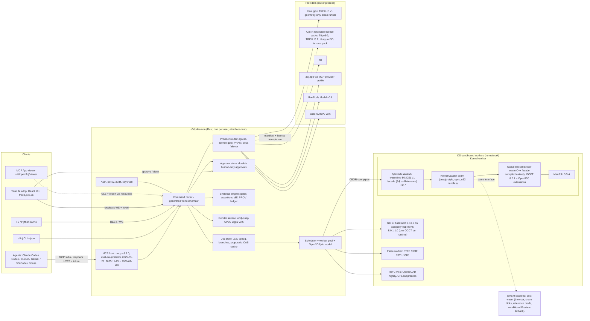

> **Archived.** This is the full-scale plan written for a funded team of 3 to 4 engineers. It was superseded on 2026-10-28 when the founder chose a lean, volunteer and AI-agent model; see [docs/PLAN.md](../../PLAN.md). It is kept for its research-backed detail. A final review still listed a few unresolved inconsistencies, so check claims against the gap notes before reusing them.

# Open3DJ: Technical Architecture

Status: revised 27 Oct 2026. Companion to [PLAN.md](PLAN.md) (key decisions in section 4 there). Versions and claims follow the verified research digest in this folder. The gap-fill notes in [research/gap-1.md](../gap-1.md) to [research/gap-9.md](../gap-9.md) are newer and more specific than the original reports, and they override them where the two conflict. Each section that changed because of a gap note cites it.

**Schedule.** This document uses version labels (Agent Preview, Public Beta, v0.6 and so on), not calendar promises. [PLAN.md](PLAN.md) section 6 owns the schedule. It gives a range, with the assumptions behind it: Agent Preview around week 12-16 and Public Beta around week 28-44 (the judges' upper bound). The judges estimated 36-44 weeks for the agent-first proposal's alpha scope, so the early end of each range is optimistic. Week numbers below are planning anchors only. Where the architecture has a built-in fallback for a slip, this document says so. The Agent Preview can ship on the WASM kernel backend if the native build slips, but only if the week-0 spike showed occt-wasm running inside the sandboxed kernel worker with the same adapter; otherwise the Preview slips (section 3.1). CadQuery stays deferred (section 2.3), and texturing stays out of the default generator (section 7.4). [PLAN.md](PLAN.md) owns the full list of what is cut first.

### Founder decisions needed

These choices affect the architecture, but only the founder (or the company's counsel and board) can make them. Decisions 1 to 8 use the same numbers, order and scope as the list in [PLAN.md](PLAN.md), so "founder decision N" means the same question in both documents.

1. **Project name (see [research/gap-5.md](../gap-5.md)).** OPEN3D is a live US registration (Reg. 6468139, class 9, downloadable open-source software for 3D data). OPEN3DJ is one letter away for near-identical goods. The options are: keep "Open3DJ" subject to counsel clearance against OPEN3D, or use a 3DJ house-mark name such as "3DJ Open" or "3DJ Workbench". Counsel review is recommended, and filing 3DJ in classes 9 and 42 (US, EU, UK via Madrid) is an option for the company. EU and UK clearance is still open because those registers were not reachable. The decision is needed in weeks 0-2, before any package listing, signing certificate or launch. Until then, every package, bundle ID and registry name in this document (`open3dj`, `@open3dj/*`, `io.github.<org>.Open3DJ`) is provisional. The project is still called Open3DJ in these documents.
2. **Who pays for the core (see [research/gap-1.md](../gap-1.md)).** The plan costs about £0.55M-0.80M fully loaded (UK payroll assumed; up to about £0.97M at the far end of the schedule range, see [PLAN.md](PLAN.md) section 7). Realistic cash grants are about €0-60k. The core needs a named payer: 3dj.app revenue, founder capital or a seed round.
3. **Staffing level.** Three engineers plus a fourth from week 12 (the plan baseline), or two engineers with durations multiplied by about 1.4. This changes the schedule, not the architecture.
4. **Employing entity and jurisdiction for R&D relief (see [research/gap-1.md](../gap-1.md)).** UK R&D tax relief is available only to a UK company. The GitHub profile places Neural Deep Network LTD in Dublin/Malta. Which entity employs the engineers decides whether UK relief or the Irish R&D tax credit applies. The Maltese position is to verify, and the burn must be re-costed for a non-UK employer. The same entity is used for Apple enrolment (D-U-N-S number) and Azure Artifact Signing validation (section 14.2).
5. **3dj.app commitments (see [research/gap-9.md](../gap-9.md)).** Any statement that 3dj.app adopts Open3DJ's WASM backend, co-owns DSL v1, adds an upload tool, or adds an evidence/hash field to print quotes is a proposal for the 3dj.app team, not a plan fact. Sections 7.2 and 12.1 depend on those answers.
6. **Restricted-licence model packs (see [research/gap-4.md](../gap-4.md)).** Tencent's territory clause excludes both the EU and the UK, so it applies to the company itself whether it is registered in the UK, Ireland or Malta, not only to its users. Whether Neural Deep offers TripoSG or Hunyuan3D packs at all (even opt-in), and what 3dj.app's hosted service runs for EU and UK customers, needs a legal decision.
7. **Windows code signing and the licence commitment SignPath needs (see [research/gap-9.md](../gap-9.md)).** Azure Artifact Signing is the Windows signing route. It is the only route that shows Neural Deep Network LTD as the publisher, and it costs about $120 a year on the Basic tier. Confirm paying for it. SignPath Foundation signing is free for eligible open-source projects but optional. It shows "SignPath Foundation" as the publisher, can only be applied for after a first public release, and requires that no Open3DJ component is ever sold under a commercial dual licence and that no closed 3dj.app component is bundled. Decide whether the company accepts that commitment permanently. If yes, the company applies to SignPath after the v0.1 Agent Preview. If no, it signs with Azure Artifact Signing only. Section 14.2 depends on this decision.
8. **Update check: on by default (opt-out) or off by default (opt-in or manual) (see [research/gap-7.md](../gap-7.md)).** Auto-update through the signed Tauri updater is part of every desktop release (sections 9 and 14.3), and it always needs a check of the release JSON on GitHub Releases. That check sends no content. The founder decides only two things: whether the check is on by default with an opt-out, or off by default (the user opts in or checks by hand); and whether per-release download counts may be used as an adoption metric. Telemetry stays off by default either way. Section 14.3 depends on this decision.

---

## 1. System overview

Open3DJ is built around a single Rust binary, `o3dj`, which owns all state and policy. Geometry, scripts, file parsers and heavy jobs never run inside that process. They run in disposable workers that are OS-sandboxed: kernel, script, parse and render workers, plus providers. Every client talks to the daemon through one command catalogue described in JSON Schema. The clients are:

- MCP agents
- the CLI
- the TypeScript and Python SDKs
- the Tauri desktop app
- the MCP App viewer
- the web playground (from v0.6)

### 1.1 Diagram in words

1. **Agents** (Claude Code, Codex, Cursor, Gemini/Antigravity, VS Code Copilot, Goose) reach the daemon by either:
   - MCP stdio (`o3dj mcp`, launched through `npx -y open3dj mcp` or `uvx open3dj mcp`); or
   - MCP Streamable HTTP on 127.0.0.1 with a bearer token.

   The server is dual-era: it answers legacy `initialize` (2025-11-25, 2025-06-18, 2025-03-26) and 2026-07-28 requests (section 2.1).
2. **Humans** use either:
   - the Tauri desktop app, which talks WebSocket JSON-RPC to the same daemon; or
   - the `o3dj` CLI.
3. **The daemon** contains these components:
   - command router, generated from `schemas/`
   - doc store: `.o3j` projects, op log, branches, proposals and a content-addressed cache
   - scheduler, worker pool and the Open3DJ job model
   - approval store: daemon-owned approval objects for human-only consent (section 5.5)
   - evidence engine: gates, assertions, diff and provenance
   - render service: snap CPU rasteriser, and wgpu from v0.6
   - provider router with the licence gate
   - auth, policy and audit log
4. **Kernel workers** are one per active (doc, branch) and bounded by RAM. Each runs:
   - the tier A QuickJS-WASM script runtime, which hosts the Open3DJ DSL v1 facade;
   - the KernelAdapter seam (brepjs-style, synchronous, opaque u32 handles);
   - the native backend behind that seam: the occt-wasm C++ facade compiled natively against OCCT 8.0.1, plus Open3DJ extensions;
   - Manifold 3.5.4.

   The same facade compiled to WASM (occt-wasm) is the browser and share-link backend. It is also a conditional fallback for the Agent Preview: it can be used only if the native build slips and the week-0 spike showed occt-wasm running inside the sandboxed kernel worker with the same adapter. Otherwise the Preview slips (section 3.1).
5. **Separate sandboxed workers** handle Python tier B, file parsing, and OpenSCAD tier C (from v0.6).
6. **Providers** run out of process: the local GPU worker (TRELLIS v1 geometry-only clean runner by default), opt-in restricted-licence model packs, fal, 3dj.app over the MCP provider profile, and later RunPod, Modal, slicers and print services.

### 1.2 Mermaid diagram



## 2. Process model

### 2.1 `o3dj` binary (daemon, CLI, MCP)

`o3dj` runs in four modes:

| Mode | Purpose |
|---|---|
| `o3dj mcp` | stdio MCP. This is the default for agents. |
| `o3dj serve` | Streamable HTTP MCP, REST/OpenAPI and WebSocket JSON-RPC, bound to `127.0.0.1` only |
| `o3dj <tool> ...` | CLI, which mirrors every tool |
| `o3dj worker --role kernel\|python\|parse` | Internal worker entry point. Launched only by the daemon, inside a sandbox. |

**MCP library (changed, see [research/gap-6.md](../gap-6.md)).** rmcp 1.4.0 implements none of MCP 2026-07-28; its newest version is 2025-06-18. The binary pins rmcp exactly in `Cargo.toml` as **`rmcp = "=3.8.0"`** (3.8.0 is the current release; 3.6 or later is required for the server-to-client rejection fix). rmcp 3.x has shipped nine releases since 2026-07-28, with breaking changes in the 3.0 betas, so expect frequent, deliberate upgrades. Every upgrade, including a patch release, is a pin change gated by the client conformance matrix (section 12.3). This is stricter than a minor-version requirement. Cargo reads both `~3.8` and gap-6's `=3.8` as `>=3.8.0, <3.9.0` (https://docs.rs/semver/latest/semver/enum.Op.html), so under either form `cargo update` could pull in a 3.8.x patch without anyone changing a pin. The full `=3.8.0` form prevents that. Codex CLI's main branch pins rmcp the same way (`=3.5.1`, see [research/gap-6.md](../gap-6.md)). rmcp fixed a Host-validation bug that allowed DNS rebinding in 1.4.0 (GHSA-89vp-x53w-74fx, https://osv.dev/vulnerability/GHSA-89vp-x53w-74fx). The research documents that fix only for 1.4.0. Whether 3.8.0 keeps it is to verify against the rmcp 3.8.0 changelog and source. The real check is the incident-replay CI test for CVE-2025-49596 (DNS rebinding, sections 8.2 and 12.1), which runs against the daemon on every PR, including each rmcp pin change.

**Dual-era server.** Most clients still open with `initialize`. The spec gives legacy clients no way to fall forward through `server/discover`, so the server must answer both eras:

| Era | How the client arrives | What the server does |
|---|---|---|
| Legacy | `initialize` with 2025-11-25, 2025-06-18 or 2025-03-26 | Opens a legacy session and negotiates the highest version both sides support |
| Modern | 2026-07-28 requests with version and capabilities in `_meta` | Serves statelessly. Implements `server/discover`, `tools/list` with `ttlMs` and `cacheScope` in deterministic order, and validates `Mcp-Method`/`Mcp-Name` headers on HTTP |

Which client speaks what, as checked on 27 Oct 2026:

| Client | Default protocol |
|---|---|
| Claude Code 2.1.312 | 2026-07-28 (probes, falls back to legacy). `MCP_PROTOCOL_NEGOTIATION=legacy` opts out |
| Codex CLI 0.165 | 2025-06-18. 2026-07-28 behind the `mcp_2026_07_28` flag, off by default |
| Gemini CLI 0.66 / 0.67-nightly | 2025-06-18. No elicitation |
| Cursor 3.21 | Up to 2025-11-25. No timeline for 2026-07-28 |
| VS Code Copilot | 2025-11-25 |

**Design rule.** The whole agent surface must work over plain `tools/list` and `tools/call` at 2025-06-18. Features from 2026-07-28 (Multi Round-Trip `input_required`, the SEP-2663 Tasks extension, `subscriptions/listen`, Skills over MCP) are add-ons that improve the experience on clients that support them. None of them is the only path to a capability.

**Attach-or-host.** Every entry point first looks for a lockfile at `~/.o3dj/run/daemon.lock`. The file is mode 0600; on Windows it is ACL-restricted to the user SID. It holds the port, the PID and a token reference.

- If a live daemon answers, the entry point attaches to it. This covers the stdio MCP shim, the CLI and the desktop app.
- If not, it hosts a daemon itself.

Many agents and the desktop app therefore share one doc store and see each other's revisions live. Every revision carries `agent: {client, model?, principal}`.

**State and concurrency.** All cross-call state uses explicit handles minted by the server: `doc_id`, `rev`, `branch`, `job_id`, `proposal_id` and `approval_id`. Handles are bound to the principal (`<principal>:<handle>`). Following the 2026-07-28 security guidance, holding a handle is never treated as authentication. Concurrency is keyed on explicit revision or ETag arguments (`base_rev`, `if_match`) passed in tool calls, **never on MCP sessions** or `Mcp-Session-Id`: legacy sessions exist and modern requests have none (see [research/gap-6.md](../gap-6.md)).

### 2.2 Kernel workers

Each kernel worker is a disposable process.

**Sandbox per OS**

| OS | Mechanism |
|---|---|
| Linux | bubblewrap with seccomp-bpf and Landlock |
| macOS | Seatbelt profile |
| Windows | AppContainer plus Job Object |

**Inside the sandbox**

- no network;
- a read-only snapshot of the project;
- a write-only output directory in the content-addressed store (CAS);
- caps on CPU time, memory, PIDs and output size.

**Protocol.** Control messages use length-prefixed CBOR envelopes over stdin/stdout pipes. Their message schemas are generated from the same catalogue as the tools. Bulk artefacts are written as files into the CAS and passed by hash, never through the pipe: `.brep`, binary tessellation with face and edge IDs, and STEP, 3MF or GLB exports. This replaces P1's open question about capnp versus flatbuffers.

**Pool sizing.** The pool holds `min(cores - 1, floor(free_RAM / worker_cap))` workers, with `worker_cap` defaulting to a hard cap of 1.5 GB. Workers are pre-forked warm. One worker is pinned per active (doc, branch), idle workers are evicted least-recently-used, and excess work queues. The earlier "unlimited parallel workers" claim is dropped. Parallel agents on different branches still run in parallel up to the RAM budget.

The memory numbers are hypotheses to measure in week 0, not facts (hypothesis H-mem in section 12.4, see [research/gap-8.md](../gap-8.md)): native worker idle RSS at most 150 MB, starter p95 peak at most 600 MB, recycle at 1 GB, hard cap 1.5 GB, and the daemon, the UI and 2 workers fitting on the 8 GB floor machine. One local measurement of native OCCT 8.0.1 through OCP showed 286 MB RSS after import and a 333 MB peak, but OCP's monolithic bindings inflate that, and a Rust worker over the facade is unmeasured. WASM field reports are worse (Tau: per-kernel heaps of 716-877 MB, recycling at 1.5 GiB; replicad #282: about 200 KB leaked per fuse). Warm-worker reuse also trades against replay determinism (section 4.4).

**Crash isolation.** Native kernel crashes are expected, not exceptional. In the gap-8 measurement, a failed fillet followed by `Shape()` without an `IsDone()` check segfaulted the whole process. The facade extensions therefore always check `IsDone()` (and `HasErrors()`) before reading a result. A crash or timeout kills one worker. The daemon returns a structured `KernelCrash` error with a replay bundle: input shapes, op, params, kernel build and platform. It saves the bundle to `~/.o3dj/crashes/`. Uploading a bundle as a GitHub issue is opt-in, and uploaded bundles join the regression corpus. Because an upload sends data to a system the user did not choose, the user must see a privacy policy and an opt-out before any upload can be enabled, as SignPath's terms require (section 14.2, [research/gap-9.md](../gap-9.md)). The v0.1 Agent Preview ships only as npm/PyPI wrappers and CLI archives, with no installer. So the CLI shows the privacy policy and the opt-out on first run, before any upload can be enabled, and crash-bundle upload stays off at v0.1 (bundles stay in `~/.o3dj/crashes/`). From v0.5 the installers also show them (section 14.3).

### 2.3 Other workers

- **Python tier B (corrected, see [research/gap-3.md](../gap-3.md)).** The earlier pin "build123d 0.13 / CadQuery 2.8 on OCP 8.0.1" cannot be installed: CadQuery 2.8.0 pins OCP below 8.0, and the two OCP builds cannot share one environment. The rules are:
  - **One OCCT per runtime.** Never ship OCCT 7.9 and 8.0.1 side by side in one tier B environment. Install exactly one OCP wheel flavour (`cadquery-ocp` or `cadquery-ocp-novtk`), because both write the same `OCP/` files and whichever installs last wins.
  - **Preferred (MVP).** `o3dj runtime add python` adds a pinned, hash-locked uv environment: CPython 3.12 or 3.13, `build123d==0.13.0` and `cadquery-ocp-novtk==8.0.1.1.0` (OCCT 8.0.1, no VTK). `uv.lock` records the wheel flavour.
  - **CadQuery deferred.** No released CadQuery supports OCP 8. CadQuery joins when 2.9.0 is released. Until then it can be offered only as an **experimental** option from a pinned master commit at or after `9a6a705`, with a uv override that keeps a single OCP flavour (`override-dependencies = ["cadquery-ocp-novtk ; sys_platform == 'never'"]`, which accepts VTK in the bundle). That override is an inference, not upstream-documented, and needs the build123d test suite to pass on the VTK wheel.
  - **Fallback.** If the Agent Preview must use only released PyPI packages with both libraries: OCP 7.9.3.1.1 with `build123d==0.12.0` and `cadquery==2.8.0`, with the uv override that keeps a single OCP wheel flavour (drop `cadquery-ocp-novtk`), recorded in `uv.lock`. Without the override, uv installs both `cadquery-ocp` (VTK) and `cadquery-ocp-novtk` 7.9.3, and they overwrite each other's `OCP/` files (see [research/gap-3.md](../gap-3.md)). This commits Open3DJ to a later 7.9 to 8 port of any raw-OCP code, which the `OCP.collections` rename makes non-trivial.
  - **Always pin CadQuery exactly.** An unpinned `cadquery` next to `build123d==0.13.0` silently resolves to cadquery 2.3.0.
  - **Known regression.** Guided and binormal sweeps give wrong volumes on OCCT 8.0.1 (build123d #1474, OCCT #1681, unfixed). Tier B carries a regression test for it, and the GeometryReport emits a warning (`SWEEP_GUIDE_OCCT_1681`) when a script uses `binormal=` or a guide, so agents avoid the construct or verify the volume.
  - **Windows ARM64 (v0.6).** Tier A runs as normal. Tier B Python has no OCP wheel there, so it uses a WASM (for example Pyodide/OCP.wasm, to verify) or remote tier B fallback.
  - The wheels are about 48-68 MB, so they are not bundled in the installer. The worker runs under the same OS sandbox with no network. It returns `.brep` plus the source-line spans that created each shape, captured through a thin OCP history wrapper.
  - Benchmark harnesses use their own separate pinned environments (build123d 0.10.0 for CAD-bench, CadQuery 2.4 for Text2CAD-Bench). Each is still one OCCT per environment.
- **Parse worker.** Untrusted STEP, 3MF, STL and OBJ files are parsed in an isolated worker with ZIP, array and size caps. DTDs are rejected. Free-text fields are returned as data marked untrusted.
- **Tier C (v0.6).** OpenSCAD nightly with the Manifold backend runs as a GPL subprocess and returns a mesh. Its top-level numeric parameters become params.

### 2.4 Desktop and SDK clients

- The desktop app is a Tauri 2.12 shell. It ships the `o3dj` binary as a sidecar and attaches to a running daemon if one exists. The UI never executes user scripts. It is the primary place where humans resolve approval objects (section 5.5).
- The TypeScript SDK (`@open3dj/sdk`) and Python SDK (`open3dj`) are generated from `schemas/` and call REST or WS. Package names are provisional until the naming decision.
- The MCP App viewer is a static `ui://open3dj/viewer` resource: three.js with a GLB loader. It reads results by resource URI and needs no kernel. Clients without MCP Apps support get the same GLB and report as resource links.

## 3. Geometry kernel strategy

### 3.1 Layers, the KernelAdapter seam and backends

**What changed (see [research/gap-2.md](../gap-2.md)).** The earlier plan described DSL v1 as "3dj.app's Replicad-style API" and implied running Replicad over the native kernel. That is dropped. You cannot put a membrane under unmodified Replicad: Replicad 1.2.0 exposes raw OpenCascade.js objects in 48 public symbols and makes 134 `getOC()` calls, so a shim would mean re-implementing opencascade.js's binding generator for about 150-250 OCCT classes. Open3DJ does not port Replicad wholesale either.

The kernel stack has four layers:

| Layer | Where it runs | What it is |
|---|---|---|
| 1. **DSL v1 facade** | QuickJS-WASM (tier A) | TypeScript implementation of the Open3DJ DSL v1 (section 3.4) plus `lib.*`. Calls only the KernelAdapter interface |
| 2. **KernelAdapter seam** | QuickJS-WASM | A brepjs-style synchronous interface over opaque `u32` handles. brepjs (Apache-2.0) defines it as 15 sub-interfaces plus 2D capability: about 280 members, none returning a Promise. Open3DJ vendors or mirrors those interfaces (with a NOTICE file) and pins the version, because brepjs moves fast (majors v9 to v20 during 2026, one maintainer) |
| 3. **Backend bindings** | wasmtime host imports | About 230 facade functions exposed to QuickJS as host imports taking and returning handles and plain values. Mostly code-generated from the facade header |
| 4. **Kernel backend** | Native, in the same worker | The occt-wasm C++ facade (about 230 functions, about 6.1k lines, OCCT 8.0.1, u32 arena handles) compiled natively, plus Open3DJ extension functions |

brepjs's existing `OcctWasmAdapter` (about 8.7k lines) implements the seam on top of the occt-wasm facade, so it can be reused nearly unchanged once the same functions are bound natively.

**Backends**

| Backend | Status | Use |
|---|---|---|
| `occt-native` | MVP, default | The occt-wasm C++ facade compiled natively against OCCT 8.0.1 (portable C++; only its generated Emscripten bindings file is WASM-specific). Open3DJ extension functions add what the robustness pipeline and element map need (section 3.2, 3.3). The Rust `Kernel` trait below calls the same facade through `cxx`. OCCT shared libraries are shipped with the app and are replaceable (LGPL-2.1 with the Open CASCADE exception) |
| `occt-wasm` | Browser and share links at v0.6; **conditional fallback for the Agent Preview** | occt-wasm 5.8.x (the same facade compiled to WASM). libcascade 3.1.0 is a benchmark comparator only (H-ratio, section 12.4), not a backend: it is an opencascade.js-style build, not the occt-wasm facade, so the reused brepjs `OcctWasmAdapter` would not run on it. Using it as a backend would need a separate adapter (for example brepjs's OCJS adapter), which is not in scope. occt-wasm is used for the browser playground, share links and a cross-architecture "reference mode" for golden replay. If the native build slips and the week-0 spike showed occt-wasm running inside the sandboxed kernel worker with the same adapter (spike step 5 below), the Agent Preview ships on this backend with the same DSL facade and adapter code. Otherwise there is no fallback and the Preview slips |
| `usd-brep` | 1.0 experiment | NVIDIA USD BRep 1.0.1 (Apache-2.0), with OCCT converters in both directions. Not adopted until it is benchmarked. It has no documented STEP I/O and NVIDIA accepts no contributions |
| `manifold` | MVP, mesh ops | Manifold 3.5.4. Used for mesh CSG, imported and generated meshes, DfAM level-set checks, 3MF preparation and the OpenSCAD path |

**Excluded.** `brepkit-wasm` (the Rust brepjs adapter) is AGPL-3.0-only and is never bundled. The brepjs public API (954 root exports, functional style, reversed fillet argument order) is not adopted as Open3DJ's DSL; only the adapter seam is.

**WASM versus native speed (to measure).** The only published comparison is taucad's libcascade benchmark, which is self-reported from one Apple M2 Pro: WASM is about 1.1-2x native on typical ops, at parity on a 40-box multi-tool fuse, 3.16x on a small fuse and about 9x on trivial primitives where call overhead dominates. WASM init is about 488 ms. occt-wasm itself publishes no timings, and wasm32 stays capped at 4 GB in WebKit because Safari's memory64 is still behind a flag. Open3DJ measures its own ratio (hypothesis H-ratio, section 12.4) before using the WASM backend for share links or reference mode (see [research/gap-8.md](../gap-8.md)).

**Open items to verify in the spike.**
- Whether, and how, the WASM fallback runs inside a sandboxed kernel worker. occt-wasm is an Emscripten build with JavaScript glue, so it may need a JS engine with WASM support (Node or an embedded V8) rather than QuickJS in wasmtime. That would change the worker runtime and the tier A sandbox layering. To verify in spike step 5. Until that step passes, the WASM fallback for the Agent Preview is not available.
- Whether the facade already exposes OCCT history (Generated, Modified, Deleted) and the BOPAlgo checks the robustness pipeline uses, or whether Open3DJ adds them as extensions.
- The licence of the occt-wasm facade source and of the patches in the OCCT fork it builds against. Gap-2 reports that its compiled output is LGPL-2.1. To verify before vendoring (spike step 6).

**Week-0 spike (1-2 weeks).**
1. Compile the occt-wasm facade natively on Windows x64, macOS (arm64 and x64), Linux x64 and Linux arm64. Linux arm64 is needed because the headless Linux arm64 CLI and MCP build is an Agent Preview target (section 14.1), and the P0 OCCT build already covers it.
2. Bind 20 facade functions into QuickJS as wasmtime host imports.
3. Run the brepjs kernel conformance tests through the vendored seam against the native build.
4. Run the performance hypotheses in section 12.4 on the same build.
5. Run the occt-wasm backend inside the sandboxed kernel worker (QuickJS in wasmtime, or an embedded JS engine if the Emscripten glue needs one) with the same adapter, and record the resulting worker runtime and tier A sandbox layering.
6. Confirm the licence of the occt-wasm `facade/` source before vendoring. If it is LGPL-2.1, it goes in a separately licensed directory or a dynamically linked library ([PLAN.md](PLAN.md) P0 licence gate).

The outcome decides whether the Agent Preview ships on `occt-native` or on the `occt-wasm` fallback:

| Native build and conformance (steps 1-3) | In-worker WASM (step 5) | Agent Preview |
|---|---|---|
| Passes | Either | Ships on `occt-native` |
| Fails | Passes | Ships on `occt-wasm`; native lands in P3 |
| Fails | Fails | No fallback; the Preview slips |

The decision is made per target. If the Linux arm64 native build fails, the linux-arm64 Preview build can use the WASM backend only if step 5 passed; otherwise that build moves to v0.6 (item 6 of the cut list in [PLAN.md](PLAN.md) section 6). The other targets stay native.

If the Preview ships on the WASM backend, the relaxed goal rules in [PLAN.md](PLAN.md) section 6 apply. G8, G12 and the reference and evidence gates apply unchanged. G9 and H-run become measured-and-published targets rather than release gates until native lands, because the WASM/native ratio is unmeasured. H-sandbox is measured on the actual WASM worker runtime and its budget is re-set from that data. H-mem uses a WASM-specific recycle threshold set from week-0 data, and the 10,000-op leak soak stays a release gate. G13 is measured on the WASM build. H-ratio does not gate this use. PLAN.md is the source for these rules.

**Effort estimate (re-estimated in [research/gap-2.md](../gap-2.md)).**
- DSL v1 facade plus `lib.*`: about 5-10k lines of TypeScript. `lib.*` is re-authored from the public reference, because 3dj.app is closed source.
- Bindings for about 230 facade functions: mostly code generation.
- Adapter: about 8.7k lines reused from brepjs.

**Rust kernel trait.** Native op nodes (features that are not scripts), the robustness pipeline and evidence measurement use a Rust trait in the worker that calls the same facade:

```rust
trait Kernel {
    fn eval(&mut self, op: &OpNode, inputs: &[ShapeRef]) -> Result<OpResult, KernelError>;
    fn history(&self, op: OpId) -> History;      // Generated / Modified / Deleted per input sub-shape
    fn query(&self, q: &TopoQuery) -> Vec<ElemId>;
    fn measure(&self, m: &Measure) -> Measured;  // with confidence = measured
    fn tessellate(&self, s: ShapeRef, tol: Tol) -> Mesh;  // carries face/edge IDs
    fn export(&self, s: &[ShapeRef], fmt: Format, opts: &ExportOpts) -> Artefact;
}
```

Script calls through the KernelAdapter and native op nodes through `Kernel` share one handle arena in the worker, so a script's output can feed a native op without copying.

### 3.2 Robustness pipeline (every B-rep op)

1. **Preconditions.**
   - Booleans: run `BOPAlgo_ArgumentAnalyzer` on the inputs, checking validity, self-interference and continuity of at least C1.
   - Fillets: check radius feasibility against the adjacent face curvature.
2. **Evaluate**, using the document tolerance, which is explicit per document. Every OCCT builder result is checked with `IsDone()` before `Shape()` is read.
3. **Retry ladder on failure.** Each step runs only if the previous one failed:
   1. safe-input mode (`SetNonDestructive`);
   2. a fuzzy-value set {1e-7, 1e-6, 1e-5, 1e-4, 1e-3} × model scale, all tried, with no monotonicity assumed;
   3. glue mode;
   4. ShapeFix healing of the inputs;
   5. a structured failure.

   Every attempt is logged in `report.ladder[]`.
4. **Post-conditions.**
   - `BRepCheck_Analyzer` validity check.
   - Closedness check.
   - Volume-intent checks:
     - a cut must not add volume;
     - a fuse result must be at least the largest input volume minus epsilon;
     - a fillet's volume change must fall within the bounds predicted from the radius.
5. **Fillets and chamfers.** When the whole edge set fails, the worker bisects the edge set to isolate the failing edges. It returns per-edge reasons and a suggested maximum radius. A partial result is applied only with `allow_partial: true`.

These steps are implemented as Open3DJ extension functions on the facade where the facade does not already expose them (section 3.1). DSL calls such as `fillet` go through the same pipeline, so a script gets the same ladder and per-edge reasons as a native op.

### 3.3 History, element map and references

**Element map.** Each element ID has the form `op_uuid:role:index`. The map is built from OCCT boolean and feature history (Generated, Modified, IsDeleted) together with BRepGraph typed node IDs. Long derived names are hashed, as in FreeCAD's element map (https://github.com/realthunder/FreeCAD_assembly3/wiki/Topological-Naming).

**References** are stored in `refs.o3j.json` as:

```json
{"name":"mount_face","query":{"createdBy":"op_01J..","role":"cap_end","adjacent":["hole_*"]},
 "fingerprint":{"type":"plane","normal":[0,0,1],"area_mm2":412.0,"centroid":[0,0,12]},
 "label":"top mounting face"}
```

Resolution works in four steps:

1. Match the history query (Onshape-style createdBy, role and adjacency).
2. If the result is unique, the state is `exact`. If the match moved to a successor element, it is `re_resolved`.
3. If several candidates remain, the geometric fingerprint is used to rank them. A unique winner above the score threshold gives `disambiguated` with its score. Otherwise the state is `ambiguous`: the candidates are returned and none is picked.
4. If nothing matches, the state is `broken`, with a reason.

**Shared token grammar.** One token form serves UI picks, chat chips, code and MCP: `@ref:<name>`, `@elem:<op>:<role>:<i>` and `@pick:<uuid>`. Agents can therefore cite exactly what a human clicked.

### 3.4 Script execution: DSL v1 and the traced membrane

**What "Open3DJ DSL v1" is (redefined, see [research/gap-2.md](../gap-2.md)).** DSL v1 is the published 3dj `dslReference` facade, the machine-readable reference that 3dj.app serves through its public `cad_get_starters` MCP tool. It is not Replicad's API and not "3dj.app's Replicad-style API". It has about 150 documented entry points:

- `Param.*`
- primitives (for example `box(w,d,h)` centred on XY with Z up, `cylinder(h,r,rTop)`)
- 2D profiles and paths
- booleans (`.add`, `.subtract`)
- transforms
- fillet, chamfer and shell with `edgeQuery` selection (`fillet(shape, r, {atZ, parallel, ...})`)
- patterns
- placement and references (`withReferences`, `attachTo`, `onFace`, `hole`, `cutout`)
- `lib.*` helpers
- connectors (`connector.male/female` with `matchTo`, `tolerance`, `minWall`)
- DfAM helpers
- `measure`

Added to that is a corpus-driven list of calls the 18 public starters use but the reference does not document: `.color()`, `.name()`, `.cutPlane(plane, offset, keep)` and `lib.bolt/nut/washer`. The list grows only from evidence (starters and observed scripts), each entry with a conformance case. The reference is a one-page cheat sheet, not a specification: it does not define edge-query tolerance, connector frames or failure behaviour. Open3DJ writes those semantics down in `rfcs/` as it implements them. Whether the 3dj.app team adopts or co-owns that specification is a proposal for them (founder decision 5), not a plan fact.

**Runtime.** The tier A script runtime is QuickJS-ng compiled to WASM, running under wasmtime 50. Its limits are:

| Limit | Mechanism |
|---|---|
| Time | `epoch_interruption` |
| Determinism (deterministic mode) | `consume_fuel` |
| Memory | `ResourceLimiter` cap (default 512 MB) |
| Stack | `max_wasm_stack` |

**Capability membrane on the KernelAdapter seam.** Scripts see only the DSL facade, opaque handles and JSON specs. There is no clock, RNG, network, filesystem or dynamic import, and no host objects (the Figma pattern). The DSL facade calls the KernelAdapter, and every adapter call (`box`, `extrude`, `fillet(edges.query(...))`, `measure`) is evaluated synchronously by the native backend in the same worker through a host import. The membrane sits at the adapter boundary: each call is appended to a trace as an `OpNode` with the source span, its inputs and the queries it used. Because the seam takes only `u32` handles and plain values, no OCCT object ever enters the script heap.

**Trace use.** The trace is saved under the script feature as a derived subgraph. That subgraph provides:

- a native tree for review;
- element-map provenance for references;
- per-op errors with `file:line:col`.

When a parameter sweep shows the trace is structurally stable, the UI offers "explode to native ops". Only script logic runs in WASM, and geometry stays native. Script and sandbox overhead is a hypothesis to measure (H-sandbox in section 12.4: p50 at most 50 ms, p95 at most 100 ms), not a promise.

**3dj compatibility is measured, never bit-parity.** 3dj.app reportedly runs OpenCascade.js 7.7.2, possibly already OCCT 8.0.1, since the starters use replicad 1.1.0's `cutPlane` and replicad runs only on OCCT 8.0.1 from v1.0.0 (see [research/gap-2.md](../gap-2.md)). The version is confirmed with the 3dj.app team in week 0, because it sets the tolerance tiers ([PLAN.md](PLAN.md) section 4). Open3DJ targets OCCT 8.0.1, whose fillet and boolean numerics differ from 7.7.2. Conformance is tolerance-based: topology counts, volume and bounding box within the tolerance tiers in [PLAN.md](PLAN.md) section 4. Each deviation is logged as a documented known-diff (section 12.1).

## 4. Native model format and provenance

### 4.1 Project layout

A project is a git-friendly directory. It can be zipped as `.o3jz` to share, and a single `*.o3j.js` file also opens as an implicit project.

```
bracket.o3j/
  project.o3j.json     # manifest: uuidv7, units "mm", up "Z", engine pins (occt 8.0.1, occt facade
                       #   version, kernel-adapter version, manifold 3.5.4, dsl 1.x), default gate
                       #   profile, tolerance
  features.o3j.json    # canonical feature DAG: script nodes (js|py|scad), native op nodes,
                       #   import nodes; later mates. Sorted keys, one node per block
  params.o3j.json      # typed params (number/bool/choice/string, unit, min/max, confidence)
  refs.o3j.json        # named references (query + fingerprint + label)
  spec.o3j.json        # executable assertions (from check{mode:clarify} or authored)
  scripts/             # *.o3j.js, *.py, *.scad
  sketches/            # v0.6 PlaneGCS sketches
  evidence.json        # Evidence Pack v2 (latest head)
  history/oplog.jsonl  # revisions: {rev, parent, branch, ops[], agent, base_rev, ts}
  history/provenance.jsonl  # PROV-O shaped ledger, hash-chained
  history/branches.json, proposals/*.json, approvals/*.json
  assets/<sha256>      # imported files + untrusted metadata sidecars
  AGENTS.md            # project conventions for agents
  .o3j-cache/          # gitignored BRep/GLB/STEP/tessellation, keyed by content hash
```

### 4.2 Serialisation and git integration

- All files use canonical JSON: sorted keys, LF line endings, fixed float formatting (shortest round-trip, in mm).
- IDs are UUIDv7.
- `o3dj git-setup` installs a git merge driver. It routes `features`, `params` and `refs` conflicts into the proposal UI instead of leaving text conflict markers.

### 4.3 Provenance

Each line in `provenance.jsonl` is one record in the PROV-O shape:

- **Entity:** feature UUID plus content hash.
- **Activity:** tool call plus argument hash.
- **Agent:** client, model and principal.
- **Relations:** `wasGeneratedBy`, `wasDerivedFrom`, `used` and `wasAssociatedWith`.

Each line includes the previous line's hash. The ledger head hash is embedded in every export. Waivers, approval decisions and human accept or reject decisions are ledger records too. A record of a human decision names the channel it came through (desktop UI or local approval page), never an MCP elicitation response alone (section 5.5).

### 4.4 Replay and determinism

`o3dj replay history/provenance.jsonl --deterministic` re-executes the ledger with:

- OCCT parallel mode off;
- fixed fuzzy values and tolerances;
- wasmtime fuel enabled;
- canonical hashing;
- a fresh worker process per replay.

It then asserts:

- **Same platform and build:** bit-identical `content_hash`.
- **Across platforms:** a `semantic_hash` (topology counts exact, plus measures quantised at a relative tolerance). The 1e-9 relative figure in [PLAN.md](PLAN.md) section 4 is a proposed value only. No research report, proposal or gap note supports it, and it sits badly with the evidence: DSL conformance across OCCT versions uses proposed 1e-6 and 1e-4 tiers, and OCCT PR #1600 shows offset results varying between processes on one platform (below). The tolerance is set from the week-0 H-det cross-OS data (section 12.4), for example tiered like the conformance suite: tighter for ops without blends, looser for fillet, loft and offset. The G13 cross-platform target for 1.0 is re-set after week 0.
- **Across architectures (from v0.6):** use the `occt-wasm` reference backend.

**Known risk to bit-identical replay (see [research/gap-8.md](../gap-8.md)).** OCCT PR #1600 (open, unreviewed) shows `BRepOffset_MakeOffset` iterating maps keyed by TShape pointer hashes, so results differ between processes and even between two builds in one process as the heap evolves. On native OCCT 8.0.1 one offset input succeeded in only 11 of 20 fresh processes. taucad fixed the same class of bug downstream in libcascade 3.1.0. Consequences:

- Same-platform bit-identity (PLAN goal G13) is a hypothesis to test in week 0 (H-det, section 12.4), including a shell and offset corpus.
- If H-det fails, Open3DJ carries a deterministic-iteration patch for BRepOffset (or adopts libcascade 3.1.0's fix upstream), or narrows G13 to ops that pass.
- Warm-worker reuse trades against replay determinism. Interactive runs may reuse warm workers; `--deterministic` replay always uses fresh processes.

## 5. Agent tool surface

### 5.1 Conventions for all tools

**Naming and metadata**
- Tool names have the prefix `o3dj_`.
- Every tool has an `outputSchema`. Results go in `structuredContent`, mirrored as compact JSON text, so clients that ignore `structuredContent` still get the result.
- Static, hashed descriptions let clients pin them.
- Server instructions are under 512 characters (Codex reads the first 512).
- **Baseline protocol.** Every tool works over plain `tools/list` and `tools/call` at 2025-06-18. Nothing a tool does depends on elicitation, `input_required`, Tasks or resource subscriptions (section 2.1).

**Response size and timing**
- `response_format: concise|detailed` (default concise). The median concise report is about 300 tokens or fewer.
- Large payloads become `resource_link` entries. This stays under Claude Code's 25k-token cap.
- No call blocks longer than 50 s; Codex's default timeout is 60 s. Longer work returns a job from the Open3DJ job model (section 5.6).

**Errors and annotations**
- Business errors come back as `isError: true` results with `{code, message, at:{file,line,col,op_id}, cause, fix, docs}`.
- Annotations are set honestly: read-only for inspect, render, diff, lib, providers and job get. Destructive is marked only for overwriting exports and `history` revert. Agent tools never delete.

### 5.2 The 16 tools

| # | Tool | Input sketch | Output sketch |
|---|---|---|---|
| 1 | `o3dj_doc` | `{action: open\|create\|fork\|list, path?, template?, from?:{doc_id,rev}, branch?, cursor?}` | `{doc_id, rev, branch, params, refs[], summary}` or a paged list |
| 2 | `o3dj_run` | `{doc_id, base_rev, source?:{lang: js\|py\|scad, code}, patch?:[{find,replace}], ops?:[add\|update\|remove_feature, set_param, make_ref, rename_ref], params?, candidates?:[source...] (≤8, best-of-N), capture?:[diff, image:iso\|front\|top\|section, checks:<profile>], dry_run?}` | `GeometryReport` plus a new `rev`. Candidates are ranked by gates, then assertions, then distance to a reference if one is given. A stale `base_rev` gives `conflict` (exit 5) |
| 3 | `o3dj_params` | `{doc_id, base_rev, set?:{k:v}} \| {sweep:{param, values[]}}` | Report, or a per-value table `{value, valid, volume, refs_states, gates}` |
| 4 | `o3dj_inspect` | `{doc_id, rev?, target:{ref\|query\|body\|elem}, fields:[topology, metrics, tree, faces, edges, sketch_dof], measure?:{kind: distance\|angle\|clearance\|thickness\|interference\|mass\|section\|probe, a, b?}}` | Values with units and `confidence` (measured, observed, inferred or assumed), plus a tree slice |
| 5 | `o3dj_render` | `{doc_id, rev?, views:[iso,front,top,right,custom], style: shaded\|edges\|xray\|ids, section?:plane, highlight?:[refs], size?, annotate?:bool, engine?: snap\|gpu}` | PNG image blocks, each captioned with camera, scale and a bbox digest |
| 6 | `o3dj_check` | `{doc_id, rev?, mode: gate\|assert\|clarify, profile?: fdm-default\|sla\|cnc-3axis\|custom, rules?, requirements?:text, store?:bool}` | `gate`/`assert`: Evidence Pack v2 `{pass, fail[{gate,value,limit,at}], unevaluated[]}`. `clarify`: `{missing[], conflicting[], assumed[], proposed_assertions[]}` (ProCAD-style) |
| 7 | `o3dj_diff` | `{doc_id, a, b, reference?:{asset\|rev}, image?:bool}` | Semantic feature diff, param diff, ref-state diff, numeric deltas, Hausdorff distance, IoU/Chamfer against the reference, changed faces, optional ghost overlay |
| 8 | `o3dj_refs` | `{doc_id, action: make\|resolve\|list, from?:{pick\|query\|elem}, name?}` | `{name, token, state, candidates?[]}` |
| 9 | `o3dj_history` | `{doc_id, action: log\|checkout\|branch\|propose\|status\|revert\|label, ...}` | Revisions, or `{proposal_id, ops[], review_url}`. Accepting a proposal is human-only: `propose` creates an approval object, resolved only in the desktop app or the local approval page (section 5.5) |
| 10 | `o3dj_export` | `{doc_id, rev, formats:[step_ap242\|step_ap214\|stl\|3mf\|glb\|obj], waive?:[{gate, reason}]}` | `resource_link[]` with sha256 and the provenance head. Blocked (exit 1) when gates fail and there is no waiver. Waivers that the gate profile marks as human-only return `approval_pending{approval_id, url}` instead of exporting (CLI exit 4) |
| 11 | `o3dj_import` | `{doc_id, source: path\|url\|asset, as: reference\|body}` | `{asset_id, bodies, metadata: <untrusted>…</untrusted>}` |
| 12 | `o3dj_lib` | `{action: search\|get, kind: part\|doc\|starter, query?, id?, cursor?}` | Paged parts with anchors and snippets, or DSL reference chunks sized for retrieval |
| 13 | `o3dj_generate` | `{kind: text_to_mesh\|image_to_mesh\|mesh_to_cad (v0.7), input, provider?, pack?, budget_usd?, egress?}` | Always `{job_id, estimate, licence_flags, approval?}` from the Open3DJ job model. On 2026-07-28 clients that declared the SEP-2663 Tasks extension, the same job is also exposed as a Task. If egress or a restricted-licence pack needs consent, the job waits on an approval object |
| 14 | `o3dj_job` | `{action: get\|cancel\|list, job_id?, approval_id?}` | `{state, progress, result?}` for jobs (exit 4 while pending). For approvals: `{state: pending\|approved\|denied\|expired, url, summary}`. This is the poll path for clients without elicitation |
| 15 | `o3dj_providers` | `{action: list\|estimate\|health\|manifest, kind?, provider?}` | Capabilities, the machine-readable licence manifest of each provider and model pack (section 7.5), territory and commercial-use flags, VRAM, pricing, health |
| 16 | `o3dj_quote` | `{action: request\|list, doc_id, rev, provider, provider_ref?, material, qty}`. `provider_ref` is the provider's own ID for the model: for 3dj, the `modelId` recorded in the doc's provenance from a `provider:3dj` generation | `{request_id, status}`. The request attaches the evidence pack and hashes where the provider accepts them (not 3dj.app today). For 3dj, the doc's content hash goes in `notes`, and a doc with no 3dj `modelId` in its provenance is refused with a structured error (section 7.2). **Acceptance is human-only**, through an approval object; the daemon then calls the provider's accept call itself |

The CLI mirrors each tool: `o3dj run --doc d --base-rev r --file part.o3j.js --json`. `o3dj check --clarify "..."` stands in for P0's `spec` tool. CLI exit codes are 0 ok, 1 gate or assertion failure, 2 script or kernel error, 3 usage or auth, 4 job or approval pending, 5 conflict. Exit 4 covers both a running job and an approval the daemon is waiting on, including an export blocked on a human-only waiver. Other CLI commands:

- `o3dj replay`
- `o3dj review` (read-only: lists pending approvals and prints the desktop or local approval page URL for each; it cannot approve or deny anything, see section 5.5)
- `o3dj skill install --target claude|cursor|codex|agents-md`
- `o3dj runtime add python`

### 5.3 GeometryReport (concise example)

```json
{"status":"ok","rev":"r_01JC..","content_hash":"b3:9f..","engine":{"occt":"8.0.1","backend":"occt-native","dsl":"1.0"},
 "bodies":[{"name":"bracket","valid":true,"closed":true,"solids":1,"faces":38,"edges":96,
   "bbox_mm":[60,40,12],"volume_mm3":14210.4,"area_mm2":7012.9,"com":[0,1.2,4.8],"mass_g":17.6}],
 "delta":{"volume_mm3":-842.1,"faces":4},
 "refs":[{"name":"mount_face","state":"exact"},{"name":"rib_edge","state":"ambiguous","candidates":2}],
 "gates":{"pass":["watertight","bed_fit"],"fail":[{"gate":"min_wall","value":0.62,"limit":0.8,"at":"@elem:op_7:side:3"}],"unevaluated":[]},
 "warnings":[{"code":"FILLET_PARTIAL","at":{"line":22},"fix":"radius <= 1.4 mm on 2 edges"}],
 "ladder":[{"op":"op_5","attempt":"fuzzy=1e-5","ok":true}],
 "next":["o3dj_refs resolve rib_edge","o3dj_render views=[iso] highlight=[@elem:op_7:side:3]"]}
```

### 5.4 Resources, prompts and skills

**Resources**
- `o3dj://doc/{doc_id}/rev/{rev}/model.glb`
- `.../report.json`
- `.../evidence.json`
- `o3dj://lib/{id}`
- `o3dj://docs/{chunk}`
- `ui://open3dj/viewer` (the MCP App)

Change notifications go only to clients that opt in: through `subscriptions/listen` on 2026-07-28 connections, and through `resources/subscribe` on legacy sessions. Agents that subscribe to nothing lose nothing: every tool result already carries the new `rev`.

**Prompts.** Three short prompts:
- `design-part`: spec, clarify, run, check, render, diff, propose.
- `repair-failure`: read the report, take the fix, rerun.
- `prepare-print`: profile, waive or fix, export 3MF, quote.

**Skills.** SKILL.md (under 5k tokens, under 500 lines) is installed as a file (`o3dj skill install`, skills.sh) and, as an add-on, served through Skills over MCP (`io.modelcontextprotocol/skills`) where the client supports it. Its loop is: clarify → run → check → render → diff → propose → export. It also covers fillet-last guidance, how to read reference states, how to handle `approval_pending`, and the guided-sweep warning from section 2.3.

**Packaging and hooks**
- Claude Code plugin: `.claude-plugin/plugin.json`, the skill, `.mcp.json`, and a PreToolUse hook on `o3dj_export` that requires passing gates or an explicit waiver. The hook is a convenience for the agent. It is not the enforcement point: the daemon enforces gates and human-only waivers itself.
- MCPB bundle for Claude Desktop double-click install.
- `server.json` in the MCP Registry.

### 5.5 Elicitation and human confirmation

**What changed (see [research/gap-6.md](../gap-6.md)).** Consent no longer rests on MCP elicitation or Multi Round-Trip `input_required`. An elicitation "accept" does not prove a human consented: Claude Code Elicitation hooks can answer `accept` automatically, and non-interactive sessions cancel input requests. MCP only delivers the prompt.

**Approval objects.** Every human-only decision is a durable approval object owned by the daemon:

- proposal acceptance;
- print-quote acceptance (and quote requests that send data off the machine). Once a human approves, the daemon itself calls the provider's accept call (for 3dj, `accept_print_quote`, section 7.2); no agent tool reaches that call;
- cloud egress consent, including making a local image publicly reachable for a provider (section 7.2);
- acceptance of a restricted-licence model pack's terms (section 7.5);
- gate waivers that the gate profile marks as needing a human.

Each object has an `approval_id`, a state (`pending → approved | denied | expired`), the principal that requested it, a summary of exactly what is being approved, and a hash of that payload (quote terms, proposal ops, egress manifest). Approving a different payload than the one shown is impossible. Objects live in `approvals/*.json` and every decision is written to the provenance ledger with the channel it came through.

**Where a human approves.** Only in these two channels, as in [PLAN.md](PLAN.md) section 4 and [research/gap-6.md](../gap-6.md):
- the Open3DJ desktop UI; or
- a local approval page served by the daemon on `127.0.0.1`, protected by a one-time nonce in the URL, the same Origin and Host checks as the HTTP transport, and a short expiry.

`o3dj review` is not an approval channel. It only lists pending approvals and prints the desktop or local approval page URL for each, which is the same URL the agent already receives in `approval_pending`. An earlier draft let `o3dj review` approve in an interactive terminal, guarded by a check that stdin is a TTY. That was removed: an agent with shell access can allocate a pseudo-terminal (`script`, `expect`, `unbuffer` or a pty library), so the check gives no more proof of a human than a hook-accepted elicitation does.

**How the prompt reaches the human (delivery adapters).**

| Client situation | Delivery |
|---|---|
| 2026-07-28 client (Claude Code default) | MRTR `input_required` carrying URL-mode elicitation that points to the approval page |
| Legacy client with elicitation (Codex, Cursor, VS Code) | `elicitation/create`: URL mode where 2025-11-25 allows it, otherwise form mode with the link |
| No elicitation (Gemini CLI), headless or non-interactive runs | A normal tool result `approval_pending{approval_id, url, summary}`; the agent polls with `o3dj_job {action: get, approval_id}` |

Whatever the adapter returns, the daemon changes the approval state only when the human acts in one of the two approval channels. Elicitation is never used to request secrets.

**Local page threat model: settled in P2, before the Agent Preview.** An agent with shell access on the same machine could try to script the local approval page. The nonce stops other web pages and other users, but not a local process that can read the URL. The desktop UI is the stronger channel, but the v0.1 Agent Preview is headless and has no desktop UI. The local page is therefore the only human approval channel at v0.1, and proposal acceptance and human-only waivers ship on it. For that reason the threat model for the local page (for example, requiring an OS-level confirmation before the page accepts a decision) is settled in phase P2, as an exit criterion for the Agent Preview, not deferred to v0.5. [PLAN.md](PLAN.md)'s P2 exit gate needs the same item.

**Open question: a terminal channel.** If a terminal approval channel is wanted later, it needs an OS-level confirmation (or a secret the agent cannot see) before it can count as human consent. A TTY check alone is not enough. Such a channel would also need its own approval-bypass probe in the CI security suite (section 12.1) before it ships.

### 5.6 Long-running work: the Open3DJ job model

Open3DJ's own job model is the universal mechanism for anything that takes longer than one call: a tool returns `job_id`, the agent calls `o3dj_job {action: get|cancel}`, and progress arrives as progress notifications and as resources where the client supports them. This works on every client at 2025-06-18.

- The SEP-2663 Tasks extension is an optional wrapper over the same jobs for 2026-07-28 clients that declare it (Claude Code from 2.1.304).
- The 2025-11-25 experimental tasks (`tasks/list`, `tasks/result`, still used by VS Code Copilot) are **not** implemented. rmcp 3.x dropped them.
- Jobs and approvals are keyed by their own IDs and by `rev`, never by MCP session, so an agent can reconnect, switch transport or hand a job to another client.

## 6. Feedback signals for agents

The signals are ordered by cost, cheapest first, following the research recommendation (https://arxiv.org/html/2603.26512). CADSmith shows that renders and kernel numbers complement each other: removing renders left mean Chamfer distance at 18.19 instead of 0.74.

1. **Structured errors.** Line-anchored, with cause, fix and docs link. Kernel errors are mapped from OCCT `HasErrors`/`HasWarnings`.
2. **GeometryReport on every mutation.** Topology, metrics, delta, reference states, gates and ladder trace.
3. **Evidence gates.** From Evidence Pack v2 profiles:
   - watertight;
   - minimum wall (BRepExtrema sampling);
   - overhang against build direction;
   - bed fit;
   - mass;
   - draft and trapped volume (from v0.6);
   - interference (from v0.8).

   Each gate reports pass, fail or unevaluated, with location.
4. **Executable assertions.** Stored in `spec.o3j.json` (CADTests-style) and rerun on every revision.
5. **Renders.** Snap multi-view, sections, highlighted references, ID-colour views and pixel diffs. Every image is captioned.
6. **Diffs.** Semantic, numeric and geometric (Hausdorff, IoU, Chamfer) against the parent revision or a reference mesh or point cloud.
7. **Sweeps and best-of-N.** `params.sweep` exposes fragile references. `run.candidates` ranks alternatives by gates and assertions.
8. **Physics/FEA providers.** Post-1.0, through providers such as CalculiX.

`next[]` hints in each report point to the cheapest useful follow-up.

## 7. Compute-provider abstraction

### 7.1 Provider trait

```rust
trait Provider {
    fn manifest(&self) -> SignedManifest;  // capabilities, models, licence manifest (section 7.5):
                                           // per-package/extension/weight SPDX or custom licence,
                                           // territory exclusions, commercial-use flag,
                                           // MAU/revenue thresholds, min VRAM,
                                           // platforms (cuda/rocm/metal/cpu), price model, egress class,
                                           // retention, region, TEE availability
    fn estimate(&self, job: &JobSpec) -> Estimate;  // usd, seconds, data leaving machine
    fn submit(&self, job: JobSpec) -> JobId;        // mirrors 3dj modelId/poll/download
    fn poll(&self, id: &JobId) -> JobState;
    fn cancel(&self, id: &JobId);
    fn fetch(&self, id: &JobId) -> Vec<Artefact>;   // into CAS, hashes recorded
}
```

### 7.2 Adapter kinds

- **Native Rust adapters:** `local.cpu`, `local.gpu`, `fal`, and from v0.6 `runpod` and `modal`.
- **MCP provider profile adapter.** Any MCP server whose tools match the profile can be a provider. The profile shape is `generate_*`, a status call and a download call for generation; and `request_quote`, `list_quotes`, `accept_quote`, `cancel_quote` and `account_status` for print quotes. The daemon calls `accept_quote` only after the matching approval object is approved (section 5.5); no agent tool reaches it directly. Credentials are OAuth 2.1 + PKCE or an API key, stored in the OS keychain through the `keyring` 4.2 crate and never passed as tool arguments.
- **`provider-http` template:** for self-hosted workers.

**3dj.app through the MCP provider profile (corrected, see [research/gap-9.md](../gap-9.md)).** 3dj.app's tools map to the profile through a declarative manifest:

| Profile call | 3dj tool |
|---|---|
| `generate_*` | `generate_from_text`, `generate_from_image_url` |
| status | `get_generation_status` |
| download | `get_model_download_url` |
| `request_quote` | `request_print_quote` |
| `list_quotes` | `list_print_quotes` (operator-issued quotes with EUR terms) and `list_print_requests` (state of each request) |
| `accept_quote` | `accept_print_quote`, called by the daemon only after the approval object is approved. 3dj's MCP server instructions say it records the customer's acceptance only; it does not charge, book production or dispatch |
| `cancel_quote` | `cancel_print_request` |
| `account_status` | `get_account_status` (whether print quotes are available to the account) |
| health and allowance | `list_providers` |

The mapping is not "thin". The 3dj tool schemas, read on 27 Oct 2026, show these gaps:

| Gap | Consequence for Open3DJ |
|---|---|
| `generate_from_image_url` takes only a publicly reachable HTTPS URL (max 12 MB). None of the 18 tools accepts file bytes, base64 or a local path | A local image would need public hosting first, which conflicts with egress consent. Neural Deep operates no bucket for this, and Open3DJ has no cloud storage of its own. There are two possible hosts: a 3dj presigned-upload endpoint (a proposal for the 3dj.app team, founder decision 5), or a bucket the user configures (S3, R2 or GCS, with its credentials in the OS keychain), on which Open3DJ creates a short-lived signed URL. Either way, each upload needs an explicit egress approval (section 5.5) that shows the image, the host, the region and the expiry. With neither host, local image-to-3D through 3dj is disabled |
| `get_model_download_url` returns GLB only | 3dj generations enter Open3DJ as meshes. STEP from 3dj is only available through its browser workbench |
| `request_print_quote` needs the `modelId` of a completed model saved in the user's 3dj account and has no file, evidence or hash field (only `notes`, up to 2000 characters) | `o3dj_quote` cannot send Open3DJ parts, evidence packs or hashes to 3dj today. Until 3dj adds an upload tool and an evidence/hash field (a proposal for the 3dj.app team, founder decision 5), v0.5 3dj quotes follow [PLAN.md](PLAN.md) section 10. A quote is allowed only for a doc whose provenance records the 3dj `modelId` of a `provider:3dj` generation. Open3DJ passes that `modelId` as `provider_ref` and puts the doc's content hash in `notes`. Any other doc is refused with a structured error, because 3dj returns GLB only and accepts no upload, so an arbitrary doc cannot be mapped to a 3dj `modelId` |
| `list_providers` reports provider health, input types and remaining allowance | The router uses it directly for health and allowance |

3dj.app's provider manifest must declare which generative models it runs and their licences, like any other provider (section 7.5). Tencent territory exclusions (EU, UK, South Korea) apply to hosted services offered to customers in those territories, and to Neural Deep Network LTD itself (founder decision 6, [research/gap-4.md](../gap-4.md)).

### 7.3 Router order

1. **Egress policy:** `local-only`, `cloud-anonymous` (metadata stripped) or `cloud-full`. Every job needs an approved egress approval unless the user has set a standing policy in the desktop UI.
2. **Licence and territory:** read from the licence manifest. For example, Tencent-licensed code and weights (Hunyuan3D, TripoSG's `triposg/` package) are excluded in the EU, UK and South Korea. That binds Neural Deep Network LTD itself, not only its users, whether the company is registered in the UK, Ireland or Malta (founder decisions 4 and 6). Non-commercial dependencies need explicit acceptance through an approval object.
3. **Hardware fit:** VRAM and platform.
4. **Cost cap:** a per-job and monthly USD cap, checked against the pre-submit estimate. A runaway job is killed.
5. **Preference:** local first.
6. **Failover:** local to cloud on OOM, missing kernels or SLA miss. Failover never moves a job to a provider whose licence or territory flags the user has not accepted.

### 7.4 Local GPU worker and model packs

`open3dj-worker` is a pinned Python environment or container. It accepts weights only as safetensors.

**Default image-to-3D (changed, see [research/gap-4.md](../gap-4.md)).** TripoSG is no longer the default. Its top-level LICENSE and weights card are MIT, but the code that has to run is not licence-clean: the `triposg/` package carries the Tencent Hunyuan FlashVDM Community License (excludes the EU, UK and South Korea), the DiT file embeds the Tencent Hunyuan Community License, the default decoder imports `diso` (CC BY-NC 4.0), the script always downloads `briaai/RMBG-1.4` (non-commercial), and it imports `pymeshlab` (GPL-3.0).

The new default is **TRELLIS v1, geometry only, through an Open3DJ-owned "clean runner"**:

| Stage | Clean-runner choice | Licence |
|---|---|---|
| Background removal | rembg with `u2net`, or BiRefNet; or an RGBA image the caller already masked | MIT / Apache-2.0; BiRefNet MIT |
| Generation | TRELLIS v1 code and `microsoft/TRELLIS-image-large` weights, DINOv2 via `torch.hub` | MIT; DINOv2 Apache-2.0 |
| Generation core dependencies | spconv; xformers or flash-attn; easydict | spconv Apache-2.0; xformers and flash-attn BSD; easydict **LGPL-3.0** (weak copyleft, not permissive). Keep easydict as an unmodified, separately installed package, or replace it with a small permissive equivalent (to decide) |
| Mesh decode | FlexiCubes (kaolin fork) | Apache-2.0 |
| Simplification | fast-simplification | MIT |
| Repair | manifold3d | Apache-2.0 |
| **Excluded** | nvdiffrast, diffoctreerast, Inria diff-gaussian-rasterization, pymeshfix, python-igraph | Non-commercial or GPL |

The clean runner calls only the geometry path and never imports the renderers. Its dependency set has no GPL, AGPL or non-commercial items; it is not purely permissive while it keeps easydict (LGPL-3.0, see [research/gap-4.md](../gap-4.md)). Its output quality is benchmarked against the upstream TRELLIS pipeline before it ships as default (to measure). The VRAM need of the geometry-only path is to verify; the compute report gave 16 GB for full TRELLIS.

**Texturing** is a separate pack. Either it is rebuilt on permissive libraries (gsplat Apache-2.0, PyTorch3D BSD or an OpenGL bake), or it is an opt-in research/non-commercial pack shown with a warning.

**Restricted-licence model packs (opt-in).** TripoSG, TRELLIS.2 (pulls `briaai/RMBG-2.0` CC BY-NC 4.0, gated DINOv3 under a custom licence with a trade-control clause, and NVIDIA's non-commercial nvdiffrast and nvdiffrec) and Hunyuan3D are installable only as restricted-licence packs. Each ships a licence manifest (section 7.5), is hidden from the router until its terms are accepted through an approval object, and is blocked where its territory clause applies.

**Routing defaults.**
- Apple Silicon routes to the cloud by default.
- Below the pack's declared minimum VRAM: cloud by default.
- Cloud providers face the same licence gate: their manifests must declare the models they run.

Open3DJ bundles no LLM. Agents bring their own. A local Qwen3-Coder-30B-A3B setup via llama.cpp or Ollama is documented for evals and air-gapped users.

### 7.5 Licence manifests for providers and model packs

Every provider and model pack ships a machine-readable licence manifest, signed with the pack. Agents can read it over MCP through `o3dj_providers {action: manifest}`, so an agent can explain why a pack is blocked. The manifest lists:

- every Python package, with version and SPDX licence;
- every CUDA extension or git-installed dependency, with the licence file it was read from;
- every weight URL (each `snapshot_download`, `from_pretrained` or `torch.hub` target, including nested configs such as TRELLIS.2's `rembg_model`), with its Hugging Face card licence;
- SPDX identifier or custom licence name and URL for each item;
- region restrictions (for example `excludes: [EU, UK, KR]`);
- a commercial-use flag and any MAU or revenue thresholds;
- whether outputs may be used to train other models.

The manifest is produced by the four-layer licence gate in CI (section 14.1), not written by hand.

## 8. Security and sandboxing model

### 8.1 Threats

- prompt-injected agents;
- agents or hooks that auto-accept consent prompts;
- malicious files (STEP, 3MF or SCAD metadata, and parser exploits);
- malicious web pages reaching loopback (DNS rebinding);
- malicious plugins or providers (rug-pull);
- local processes stealing tokens;
- cloud operators.

### 8.2 Layers

1. **Script isolation.** QuickJS-WASM with a capability membrane at the KernelAdapter seam (opaque handles only), then wasmtime limits, then the OS sandbox. That is three layers for tier A and two for tier B. Static validation is never treated as a security boundary: 3dj's `cad_validate_script` accepted `fetch`, `eval` and `while(true)`, and a script calling `getOC()`.
2. **Workers.** No network, path jails (realpath plus no-follow checks, which close the CVE-2025-53109/53110 classes), read-only inputs, caps on everything. Native kernel crashes are contained to one worker (section 2.2).
3. **Daemon transport.**
   - stdio is the default.
   - HTTP binds only to `127.0.0.1`. It validates Origin (403 otherwise) and Host on every request. On 2026-07-28 requests it also requires and validates `Mcp-Method`/`Mcp-Name` headers; legacy sessions, which do not send them, rely on Origin, Host and the token.
   - A per-install random bearer token is kept in the OS keychain.
   - Desktop WebSocket connections use the same token.
   - Nothing binds to `0.0.0.0` by default.
   - The daemon does not rely on Chrome's Local Network Access prompt.
4. **Human consent.** Human-only decisions are approval objects owned by the daemon and resolved only in the desktop UI or the nonce-protected local page (section 5.5). No MCP response, elicitation result, agent message or terminal input is accepted as consent; `o3dj review` only lists pending approvals.
5. **Untrusted content.** File metadata, STEP header fields, SCAD comments and `echo()` output, and provider responses are returned inside `<untrusted source=...>` delimiters. ANSI and control characters are stripped. File-derived text never goes into tool descriptions or instructions.
6. **Tool-surface integrity.** Descriptions and schemas are static and versioned with hashes. `list_changed` is emitted only on upgrade. Any change to a plugin, provider or model-pack manifest triggers re-approval (the CVE-2025-54136 class).
7. **Provider egress.** Explicit deny of 10.0.0.0/8, 172.16.0.0/12, 192.168.0.0/16, 100.64.0.0/10, fc00::/7, link-local and metadata endpoints. Sandbox-runtime does not deny private ranges by default. Before and after any job that leaves the machine, the UI shows what leaves. Making a local file publicly reachable (for example a signed upload URL for 3dj image input, on a host listed in section 7.2) is an egress event with its own approval. URLs are opened only through a scheme allow-list, never through a shell (the CVE-2025-6514 class).
8. **Secrets.** `keyring` crate. Plaintext fallbacks are detected and the user is warned. Short-lived tokens with rotating refresh tokens.
9. **Supply chain.**
   - Sigstore-signed releases with SLSA L2 provenance.
   - npm and PyPI trusted publishing.
   - Plugins are WASM components with declared capabilities and signatures.
   - Native plugins are allowed only in an explicit trusted tier.
   - Model packs carry signed licence manifests produced by the four-layer licence gate (sections 7.5, 14.1).
   - The MCP library is pinned exactly (`rmcp = "=3.8.0"`, section 2.1), and each upgrade, including a patch release, must pass the client conformance matrix.
10. **Program.**
    - SECURITY.md and a CVE process.
    - cargo-fuzz on all readers (applying to OSS-Fuzz).
    - An incident-replay CI suite covering CVE-2025-49596 (DNS rebinding/CSRF), 53109/53110, 54136, 6514, ANSI injection, and an auto-accepting elicitation hook that must not resolve an approval.
    - A bounty before 1.0.

## 9. Desktop client stack and rendering

**Shell.** Tauri 2.12, with per-window capabilities, strict CSP, the isolation pattern and a signed updater. Auto-update through the signed updater ships in every desktop release and is never cut. It always needs a content-free check of the release JSON on GitHub Releases. Only the check's default state (on with an opt-out, or off until the user opts in or checks by hand) depends on founder decision 8 (section 14.3).

**UI.** React 19, Vite, Radix and Tailwind, Zustand, and CodeMirror 6 with an o3dj-js language server (generated typings for the DSL v1 facade: `Param`, `lib` and the documented entry points). The same `packages/ui` bundle is reused by the web playground (v0.6) and the MCP App viewer.

**Viewer.** three.js r186 `WebGPURenderer` with TSL materials and automatic WebGL2 fallback. `forceWebGL` is set on Linux WebKitGTK.

- Batching: BatchedMesh for B-rep faces and edges; InstancedMesh for repeated `lib` parts.
- Picking: GPU ID-buffer picking keyed on element-map IDs, plus BVH raycasts for snapping and measuring.
- Sections: clipping-plane sections.
- Large scenes: pixel culling, which never affects the BOM.

**Performance targets (hypotheses to measure, see [research/gap-8.md](../gap-8.md)).** 60 fps orbit of a 100k-triangle part at 1440p on an RTX 3060, and on Iris Xe under WebGL2. These are targets to test on the reference machines in section 12.4, not measured facts. The Iris Xe frame-time gate runs on Windows first, because the main professional CAD packages (SOLIDWORKS, Creo, NX, Solid Edge, Inventor) are Windows-only; no survey of CAD users' OS exists ([research/gap-8.md](../gap-8.md)). The Linux WebKitGTK result decides the Electron fallback.

**Linux.**
- A first-launch frame-time probe detects software WebGL2, because the renderer string is masked.
- NVIDIA workarounds are applied only when the NVIDIA module is detected: `__NV_DISABLE_EXPLICIT_SYNC=1` first, then `WEBKIT_DISABLE_DMABUF_RENDERER=1`. They are never applied if the user has set them to 0.
- An Electron 45 Linux build is the fallback if the Linux renderer gate in phase P4 fails ([PLAN.md](PLAN.md) gives its date).

**Main surfaces**
- Feature tree with reference-state badges and agent colour tags.
- Params panel with confidence labels.
- Code editor.
- Evidence cards.
- **Proposal inbox:** each agent turn is grouped; accept, reject or edit-then-accept per op; one undo entry per op; a declined-ops log.
- **Approvals inbox:** every pending approval object (proposals, quotes, egress, licence acceptance, human-only waivers) with the exact payload being approved.
- **Compare:** Base blue / Target red with a slider and a flip key; numeric delta card first.
- **What the agent saw:** the snap renders and camera trail.
- **Presence:** "Agent B is editing sketch_4", and follow-agent.

**Interaction.** Navigation presets: Zoo, Onshape, SolidWorks, NX, Creo, AutoCAD, Trackpad and Blender. Fuzzy command palette, view cube, measure-on-select, Esc cancels everything. Dark and light themes.

**Accessibility.** WCAG 2.2 targets: keyboard alternatives to dragging, target sizes, visible focus.

**Hardware floor.**
- 64-bit x86 or arm64, 4 cores, 8 GB RAM. Whether the daemon, UI and 2 workers fit in 8 GB is hypothesis H-mem (section 12.4).
- Any GPU with WebGL2, Vulkan 1.1 or Metal (Intel UHD 620 or newer).
- Windows 10+, macOS 13+, Linux with glibc 2.28+.
- Installers 60-120 MB.

## 10. File format matrix

| Format | Read | Write | Phase | Implementation | Evidence carriage |
|---|---|---|---|---|---|
| `.o3j` / `.o3jz` / `*.o3j.js` | ✓ | ✓ | MVP | native | Native `evidence.json` and ledger |
| STEP AP242DIS (default) | ✓ (AP242 parts) | ✓ | MVP | OCCT XDE (`write.step.schema=5`) | V5_UUID persistent IDs, validation properties, user-defined attributes (confidence, ledger head), ± tolerances. PR #1647 features are not assumed until a tagged release ships them |
| STEP AP214 / AP203 | ✓ | ✓ | MVP / v0.6 | OCCT | Attributes |
| 3MF (ISO/IEC 25422:2025) | ✓ | ✓ | MVP | lib3mf 2.5 (BSD-2) | Production UUIDs, `o3j:` namespaced metadata (`preserve="true"`), MustPreserve `Metadata/o3j_evidence.json` |
| STL (binary) | ✓ | ✓ | MVP | native / Manifold | `.evidence.json` sidecar keyed by SHA-256 |
| GLB / glTF 2.0 | ✓ | ✓ | MVP | OCCT RWGltf (Draco optional) | `KHR_xmp_json_ld` per node. Also the only format 3dj.app's MCP returns |
| OBJ | ✓ | ✓ | MVP | OCCT | Sidecar |
| BREP (OCCT) | ✓ | ✓ | MVP | OCCT | Cache and debug only |
| IGES | ✓ | – | v0.6 | OCCT (reads serialised; IGES read is not thread-safe) | – |
| DXF (R12/R2018), SVG | – | ✓ | v0.6 | Sections and HLR projections, in-house writer | Header comment with ledger head |
| PLY | – | ✓ | v0.6 | OCCT | Sidecar |
| `.gcode.3mf` | – | via provider | v0.6 | OrcaSlicer/Bambu CLI (AGPL subprocess) | Carried through |
| QIF 3.0 results | – | ✓ | post-1.0 | Native XML | Native |
| USD (mesh) | – | ✓ | post-1.0 | OpenUSD library | Custom layer metadata |
| IFC | plugin | plugin | post-1.0 | IfcOpenShell (LGPL-3), out of process | – |

## 11. Plugin system

**Kinds**
1. `lib` packs: o3dj-js parts with anchors and specs, data only plus scripts written against DSL v1. These run in the same membrane.
2. Check rules: WASM components implementing `gate(shape_info) -> result`.
3. Importers and exporters: WASM components running in the parse worker.
4. Providers and model packs: native, MCP profile or HTTP. Model packs carry a licence manifest (section 7.5).
5. UI panels: from 1.0, in iframes with a postMessage API.

**Requirements for every plugin**
- A manifest declaring capabilities.
- An SPDX licence (per dependency, extension and weight file for providers and model packs).
- A Sigstore signature and digest pinning.
- Re-approval on any manifest change.

**Licence boundary.** GPL plugins (BOLTS, FreeCAD Fasteners, OpenSCAD) live in separate repositories and run out of process. Restricted-licence model packs (section 7.4) also live outside the core repository and are never installed by default.

**Registry.** At 1.0, a namespace-verified registry. Until then, plugins come from git URLs pinned by digest.

## 12. Testing and evaluation strategy

### 12.1 Geometry and contract suites (every PR unless noted)

- **Contract and parity:** generated MCP, CLI and SDK schemas must be byte-identical. Every tool has golden request/response pairs. Fuzzed inputs must never produce a protocol error where `isError` is expected.
- **Kernel corpus:** about 300 ops covering booleans, fillets (a 50+ part fillet corpus), shells and lofts. Expected topology and metrics, ladder outcomes and the set of known failures. Replay bundles join this corpus. A failed-op corpus checks that every failure returns a structured error and never a worker segfault.
- **KernelAdapter conformance:** the brepjs kernel conformance tests run against the native facade build and the occt-wasm build. Both backends must pass the same set, with known differences listed.
- **DSL v1 conformance:** the 18 public 3dj starters plus 100 authored cases, including one case for each corpus-driven undocumented call. Comparison is tolerance-based (volume, bounding box, topology counts) at the tiers in [PLAN.md](PLAN.md) section 4, never bit-parity. 3dj.app reportedly runs OpenCascade.js 7.7.2, possibly already OCCT 8.0.1, since the starters use replicad 1.1.0's `cutPlane`. The version is confirmed with the 3dj.app team in week 0, because it sets the tolerance tiers ([PLAN.md](PLAN.md) section 4). Open3DJ runs OCCT 8.0.1. Each deviation is a documented known-diff. The provider-profile conformance suite runs against the 3dj adapter and a mock.
- **Tier B:** the build123d test suite on the pinned OCP wheel flavour; a regression test for guided and binormal sweeps (build123d #1474, OCCT #1681); and, only if experimental CadQuery is enabled, the CadQuery suite in the same single-flavour environment.
- **Reference stability:** a 1,000-edit randomised parameter sweep over 30 golden parts. Release gate: at least 95% exact or re-resolved and zero silent mis-resolutions, verified against ground-truth element IDs from the history.
- **Exchange:** a 150-part STEP AP242 round-trip corpus, cross-read by FreeCAD 1.1 and OCP (nightly). NIST PMI test models. 3MF validation with lib3mf. GLB validation with the Khronos validator.
- **Determinism:** replay hash equality on each platform (H-det in section 12.4, including the shell and offset corpus). A semantic hash across platforms. From v0.6, agreement between the native and WASM backends.
- **Rendering:** snap golden images (exact pixels) on all OSes. Viewer screenshot tests with a tolerance, using Playwright.
- **Performance:** the hypotheses in section 12.4, nightly on the reference machines.
- **Licence gate:** the four-layer scan from section 14.1 runs on every PR that touches dependencies, providers or model packs, and fails when a default pack gains a non-commercial, GPL or territory-restricted item.
- **Security:** fuzzing (nightly), incident replay, sandbox escape probes (network, filesystem, process spawn) on each OS, and approval-bypass probes (auto-accepting elicitation, replayed nonce, mismatched payload hash, and an agent driving `o3dj review` through a pseudo-terminal, which must not change any approval state).

### 12.2 Agent evals (`o3dj-bench`, nightly and per release)

- **Agent suite:** 150 tasks at launch, split 50 create, 50 edit and 50 repair. Each task has:
  - an executable assertion set;
  - a gate profile;
  - an optional reference geometry.
- **Clients and models:** run through Claude Code, Codex and Cursor CLI with frontier models, and through a local Qwen3-Coder-30B-A3B tier.
- **Metrics:** success, tool calls, tokens, wall time, USD, error recovery rate and invalid-output rate.
- **Baselines** run under the same harness: build123d-mcp, and Zoo MCP and SolidCraft MCP where they can run. SolidCraft ships on the Rust truck kernel (vendored, Apache-2.0), with a separate experimental SolidCore SMLib port in development, and already ships fillets, assemblies and sheet metal. Open3DJ competes on verification, evidence, references, security and providers, not on feature count.
- **External benchmarks:**
  - CADGenBench (Hugging Face, 81 STEP-submission tasks: 49 generation from drawings, 32 edits; invalid solids score 0). Target per [research/gap-9.md](../gap-9.md): at launch, at least build123d-mcp's best validated score with the same model and effort (currently 0.8298, rounded 0.830, with Claude Opus 5.5 at max effort), in the validated tier; stretch, at least the best validated score overall at release (today that is the same build123d-mcp row; the top unvalidated score is 0.8482). The earlier "0.457" figure was a June row using GPT-5.5 and is out of date. Each submission includes a request for maintainer validation.
  - CAD-bench: pinned build123d 0.10.0.
  - CADBench: permissive families only. The Fusion 360-derived subsets are non-commercial and excluded.
  - Parametric CAD Bench via freecad-validator (Apache-2.0) from v0.6.
  - MUSE from v0.8.
- **Ablations:** JS DSL v1 versus build123d on the same 200 prompts (CadQuery is added once 2.9.0 ships or the experimental pin is enabled). Report verbosity (concise versus detailed). Render engine on versus off.
- **Release gates:** G1, G4, G7, G8, G11, G12 and G13 from [PLAN.md](PLAN.md) section 2. Gates use executable assertions and invalidity rate, not IoU alone.

### 12.3 MCP client conformance matrix (CI)

Every release, and every rmcp upgrade, runs the agent smoke suite (open, run, check, render, export, a long job, and one approval round trip) against each client below (see [research/gap-6.md](../gap-6.md)). Pass means the whole core surface works and no approval can be resolved by the client alone.

| Client and mode | Protocol exercised | What must work |
|---|---|---|
| Claude Code, default | 2026-07-28 | Core surface; MRTR `input_required` with URL-mode elicitation; SEP-2663 Tasks wrapper |
| Claude Code, `MCP_PROTOCOL_NEGOTIATION=legacy` | Legacy `initialize` | Core surface; elicitation delivery |
| Claude Code with an auto-accepting Elicitation hook | Either | Approval stays `pending` until a human acts |
| Codex CLI, `mcp_2026_07_28` off (default) | 2025-06-18 | Core surface; `elicitation/create` delivery |
| Codex CLI, flag on (with `CODEX_MCP_PROTOCOL_VERSION=2026-07-28` for stdio) | 2026-07-28 | Core surface |
| Gemini CLI | 2025-06-18, no elicitation | Core surface; `approval_pending` plus `o3dj_job` polling |
| VS Code Copilot | 2025-11-25 | Core surface; no reliance on its experimental tasks |
| Cursor | Up to 2025-11-25 | Core surface; elicitation delivery. Manual run per release, with Windows checked separately because of a reported elicitation hang |
| Official MCP conformance suite | All supported versions | Pass |
| rmcp client in `Auto` mode | Both eras | Pass |

### 12.4 Performance and determinism hypotheses (week 0, then nightly)

The earlier fixed targets (run under 1 s, sandbox overhead at most 50 ms, WASM speed, RAM floor, determinism) were not measured. They are restated as hypotheses with a protocol (see [research/gap-8.md](../gap-8.md)). Each result is a go/no-go input, not a promise, and raw JSON from every machine is published.

**Reference machines:** a Windows x64 Iris Xe laptop (16 GB), an M-series Mac, a GitHub Linux x64 runner, and an 8 GB floor machine.

| ID | Hypothesis | Protocol |
|---|---|---|
| H-run | Warm `run` on the 18 starters: p50 under 1 s, p95 under 2 s | Broken down by stage (script, kernel, tessellation, report, snapshot) on each reference machine |
| H-sandbox | Sandbox overhead p50 at most 50 ms, p95 at most 100 ms; cold worker spawn at most 1.5 s | Sandboxed warm run minus the same run unsandboxed in-process on the same machine. Cold spawn reported per OS, including Windows AppContainer, for which no published figure exists |
| H-mem | Native worker idle RSS at most 150 MB; starter p95 peak at most 600 MB; recycle at 1 GB; hard cap 1.5 GB; daemon, UI and 2 workers fit on 8 GB | Includes a 10,000-op leak soak |
| H-ratio | WASM/native at most 2x p50 on the starters | occt-wasm, libcascade 3.1.0 and native side by side on the same machine. Must pass before the WASM backend is used for share links or reference mode. It does not gate the conditional Agent Preview fallback, which has its own rules (section 3.1) |
| H-det | Hash equality across 20 fresh processes and 20 warm-worker reuses | On each OS, for the starters plus a shell and offset corpus. If it fails, carry the PR #1600 or libcascade patch, or narrow G13. The same runs record measure deltas between OSes, which set the cross-platform `semantic_hash` tolerance tiers and the G13 1.0 cross-platform target (section 4.4) |

Known data points so far: one native OCP run on a 4-vCPU Linux Xeon measured a fuse at 3.0 ms, a 12-edge fillet at 6.9 ms, a 100-hole plate cut at 145 ms, cut plus mesh plus STEP write at 311 ms, and a 0.83 s cold import. bubblewrap starts in about 3-9 ms with a small mount table. The matched WASM run has not been done yet; it belongs in the week-0 spike.

## 13. Repository layout (monorepo)

```
open3dj/
├── schemas/                 # JSON Schema catalogue: tools, GeometryReport, EvidencePack v2,
│                            #   provider profile, licence manifest, approval object,
│                            #   .o3j files (single source of truth)
├── crates/
│   ├── o3dj/                # the binary: daemon, CLI (clap), MCP (rmcp "=3.8.0", dual-era), REST/WS
│   ├── o3dj-codegen/        # schemas -> Rust types, MCP defs, clap, TS/Py SDKs, docs;
│   │                        #   facade header -> QuickJS host-import bindings
│   ├── o3dj-core/           # doc model, op log, branches, proposals, approvals, refs, provenance
│   ├── o3dj-kernel/         # Kernel trait, robustness pipeline, element map
│   ├── o3dj-occt-sys/       # cxx bridge over the native occt facade
│   ├── o3dj-mesh/           # Manifold bindings, DfAM checks
│   ├── o3dj-script/         # wasmtime host, QuickJS membrane, KernelAdapter host imports, tracing
│   ├── o3dj-sandbox/        # bwrap/Landlock/seccomp, Seatbelt, AppContainer+Job profiles
│   ├── o3dj-worker/         # worker entry points + CBOR protocol
│   ├── o3dj-evidence/       # gates, assertions, clarify, diff
│   ├── o3dj-exchange/       # STEP/3MF(lib3mf)/STL/GLB/OBJ
│   ├── o3dj-snap/           # deterministic CPU rasteriser
│   └── o3dj-providers/      # trait, router, licence gate, native + MCP-profile adapters
├── cpp/occt-facade/         # vendored occt-wasm C++ facade (pinned) + Open3DJ extensions
│                            #   (history, checks, IsDone guards); built natively (CMake) and to WASM
├── packages/                # pnpm workspace
│   ├── kernel-adapter/      # vendored/mirrored brepjs KernelAdapter interfaces + occt adapter
│   │                        #   (Apache-2.0, NOTICE)
│   ├── dsl/                 # Open3DJ DSL v1 facade (3dj dslReference) + lib.*
│   │                        #   (bundled into the QuickJS image)
│   ├── sdk-ts/  ui/  viewer/  viewer-mcp-app/  lsp/
├── python/
│   ├── open3dj/             # Python SDK + uvx wrapper
│   └── worker-py/           # tier B runtime (uv.lock records the single OCP wheel flavour)
├── apps/
│   ├── desktop/             # Tauri 2.12
│   ├── web/                 # v0.6 playground (WASM backend)
│   └── docs/                # docs site; DSL reference chunks for retrieval
├── library/                 # lib.* parts with specs (Apache-2.0 sources: bd_warehouse/cq_warehouse, ISO tables)
├── providers/               # 3dj manifest, provider-http template, open3dj-worker (GPU) container,
│                            #   clean-runner/ (TRELLIS v1 geometry-only); restricted packs live in
│                            #   separate repositories with their own manifests
├── integrations/            # claude-code-plugin, mcpb, cursor, codex, gemini, skills/, npm-wrapper, pypi-wrapper
├── bench/                   # contract, kernel-corpus, step-roundtrip, ref-sweep, agent-suite,
│                            #   perf-hypotheses, external harnesses
├── conformance/             # dsl-v1 (3dj starters), kernel-adapter, provider-profile, mcp-clients
├── security/                # incident-replay, fuzz targets, sandbox probes, approval-bypass probes
├── rfcs/                    # RFCs + experiments/
└── AGENTS.md  GOVERNANCE.md  CHARTER.md  SECURITY.md  NOTICE  LICENSE-MIT  LICENSE-APACHE
```

## 14. CI, release and distribution pipeline

### 14.1 CI

- **Platform:** GitHub Actions.
- **Prebuilt OCCT:** a separate `occt-build` workflow builds OCCT V8_0_1 shared libraries and the native occt facade per target, publishes them as signed, cached artefacts, and rebuilds only when its pin changes. The same workflow builds the WASM facade.
- **Build cache:** sccache.
- **Platform priority (changed, see [research/gap-8.md](../gap-8.md)).** The priority rests on developer surveys and on which platforms CAD packages support, not on gaming-platform share. Developer data: Stack Overflow 2025 professional use is Windows 49.5%, macOS 32.9%, Ubuntu 27.7% and WSL 16.8% (the 2026 survey dropped the OS question); JetBrains has macOS and Windows tied at about 58% each and Linux at about 47% of an estimated 20.8 million professional developers in 2025 (JetBrains data playground; edition not labelled on the page); a self-selected Pragmatic Engineer poll (Sep 2026) gave macOS 62-66%, Linux 20-24% and Windows 12-13%. No survey of CAD users' OS exists, but SOLIDWORKS, Creo, NX, Solid Edge and Inventor are Windows-only. So:
  - for agent and CLI work, macOS arm64 and Linux x64 (including WSL2 and containers) come first, with Windows x64 still shipping at the Agent Preview;
  - for the professional desktop UI, Windows x64 comes first, macOS second, Linux best-effort.
- **PR matrix (Agent Preview):** `windows-x64`, `macos-universal` (built on arm64 and x64 and combined with lipo), `linux-x64`, plus `linux-arm64` as a **headless CLI and MCP target only** (Docker on Apple Silicon and arm CI runners; OCP 8.0.1 ships aarch64 wheels). `windows-arm64` and the arm64 desktop UI join at v0.6. Windows ARM64 has no OCP wheel, so tier B there uses the WASM or remote fallback (section 2.3).
- **Nightly:** GPU and performance runners on the reference machines (section 12.4), the STEP round trip, the agent suite and fuzzing.
- **Client conformance:** the matrix in section 12.3, on every release and every rmcp upgrade.
- **Licence gate (four layers, see [research/gap-4.md](../gap-4.md)).** A pip-metadata check alone would not catch TripoSG's Tencent licence, which sits in a subfolder LICENSE file and a file header. The gate scans:
  1. package metadata: cargo-deny, pnpm licence check and pip metadata;
  2. LICENSE files of git-installed and CUDA extensions;
  3. Hugging Face card `license`/`license_name` for every downloaded weight, including nested configs;
  4. in-file licence headers, with ScanCode.

  It fails on GPL, AGPL, non-commercial or territory-restricted (for example Tencent) licences in the core and in default packs, and it generates the licence manifests in section 7.5. Restricted-licence packs pass only if their manifest flags every such item.

### 14.2 Per-platform artefacts

All package names below (`open3dj`, `@open3dj/*`, `io.github.<org>.Open3DJ`) are provisional until the naming decision in weeks 0-2 (founder decision 1, [research/gap-5.md](../gap-5.md)). No listing, signing certificate subject or registry entry is created before that decision.

| Platform | Artefacts | Signing | Channels |
|---|---|---|---|
| Windows x64 (arm64 v0.6) | `o3dj.exe` CLI zip; NSIS `.exe` and `.msi` desktop installers, each with an uninstaller | See "Windows signing" below | GitHub Releases, winget, npm/PyPI wrapper, Microsoft Store EXE with offline WebView2 (v0.6) |
| macOS universal | CLI tarball; `.dmg` plus `.app.tar.gz` (updater) | Developer ID plus notarisation in CI. Apple Developer Program: 99 USD a year, charged in local currency plus tax. Organisation enrolment needs a D-U-N-S Number, legal-entity status and a website on the company's own domain; start the D-U-N-S lookup for Neural Deep Network LTD in week 0 | GitHub Releases, Homebrew cask (notarisation is mandatory since Homebrew removed `--no-quarantine`), Homebrew formula for the CLI, npm/PyPI |
| Linux x64 (arm64 CLI at Agent Preview, arm64 desktop v0.6) | CLI tarball; AppImage (static type-2 runtime), `.deb`, `.rpm`; Flatpak `io.github.<org>.Open3DJ` (v0.6) | Sigstore and GPG-signed repo metadata | GitHub Releases, Flathub, AUR (community), npm/PyPI, container image for the headless CLI |
| npm `open3dj` | Wrapper plus `@open3dj/cli-<os>-<arch>` optionalDependencies | npm trusted publishing with provenance | `npx -y open3dj mcp` |
| PyPI `open3dj` | Platform wheels containing the binary, plus the Python SDK | PyPI trusted publishing | `uvx open3dj mcp`, `pip install open3dj` |
| Agent packaging | Claude Code plugin, `.mcpb`, `server.json`, `SKILL.md` | Sigstore | Plugin marketplace, MCP Registry, skills.sh, `o3dj skill install` |

**Windows signing (corrected, see [research/gap-9.md](../gap-9.md)).**

| Route | Eligibility and terms | Publisher shown | When |
|---|---|---|---|
| Azure Artifact Signing (first route; publisher Neural Deep Network LTD) | Basic $9.99/month for 5,000 signatures (about $120/year), Premium $99.99/month for 100,000, overage $0.005 per signature. No free, trial or sponsored Azure subscriptions. Public Trust is available to organisations in the US, Canada, EU, UK, Australia, New Zealand, Japan, South Korea, Singapore, Switzerland, Norway and Israel; individuals only in the US or Canada. Neural Deep Network LTD qualifies whether registered in the UK, Ireland or Malta (founder decision 4). Identity validation takes 1-20 business days, with documents under 12 months old. A "three years of history" rule appears only in 2025 Q&A answers, not in current docs: residual risk | Neural Deep Network LTD (the validated legal name) | Start organisation validation in week 0, in parallel, so it can sign the v0.1 Agent Preview |
| SignPath Foundation (free for eligible OSS, after the first release) | The project must already be released in the form to be signed and, for executables, have "a certain verifiable reputation"; acceptance is discretionary. OSI-approved licence with no commercial dual-licensing of any component. No proprietary components, especially from the maintainer or an affiliated company (so no closed 3dj.app parts). Verifiable CI builds, manual approval of every release, multi-factor login for all members on SignPath and GitHub, named authors, reviewers and approvers, a "Code signing policy" section on the home and download pages, enforced product name and version metadata. Software that sends data to systems the user did not choose needs a privacy policy shown at install and an opt-out; installers need an uninstaller | "SignPath Foundation" | Only if the founder accepts founder decision 7: apply immediately after the v0.1 Agent Preview (weeks 12-16), the first public release. Publish the signing policy, roles, MFA setup and privacy text first. The Preview has no installer, so its CLI shows the privacy policy and the opt-out on first run, before any upload can be enabled, and crash-bundle upload stays off at v0.1 (section 2.2) |

Neither route gives instant SmartScreen reputation. If Azure organisation validation is still pending at the Agent Preview, the Windows build ships unsigned and documents the expected SmartScreen warning, as [PLAN.md](PLAN.md) section 5 says.

### 14.3 Release train

- Weekly preview builds (`-preview.N`) and monthly minor releases. Patch releases as needed.
- Desktop apps update through the signed Tauri updater with static JSON on GitHub Releases. Package-manager channels (deb, rpm, Flatpak) update through their own managers.
- Auto-update always needs a check of that release JSON, and the check sends no content. Founder decision 8 sets only its default state: on by default with an opt-out, or off by default (the user opts in or checks by hand). It also decides whether per-release download counts are used as an adoption metric. With the check on by default, those counts give an upper bound on the active desktop base without content telemetry (see [research/gap-7.md](../gap-7.md)). Telemetry stays off by default either way.
- Opt-in crash-bundle upload and any opt-in telemetry are covered by a privacy policy with an opt-out, as SignPath's terms require. From v0.5 the installers show it during installation. The v0.1 Agent Preview has no installer, so the CLI shows the policy and the opt-out on first run, before any upload can be enabled, and crash-bundle upload stays off at v0.1 (section 2.2). Every installer ships an uninstaller.
- Every artefact carries a Sigstore signature, an SLSA provenance attestation and an SBOM (CycloneDX). Model packs also carry their licence manifest.

### 14.4 Release gates

These must all be green before a release:
- contract parity;
- conformance (DSL v1, KernelAdapter, provider profile);
- MCP client conformance matrix;
- reference sweep;
- exchange;
- determinism (within the scope H-det established);
- licence gate;
- security replay;
- agent-suite thresholds.

Every release publishes its results to the public benchmark page.
