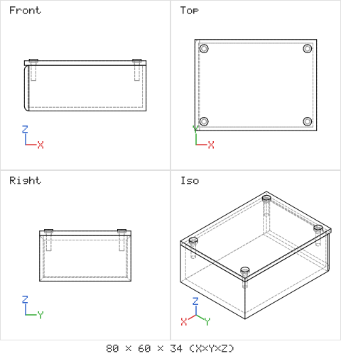

# Spike: multi-part assemblies with occt-wasm (2026-10-28)

The founder requires Open3DJ to handle complex assemblies from the start. This spike checked whether the starting kernel, occt-wasm 5.8.1 on Node.js 22, can build, export and re-import a real multi-part assembly. The scripts are in [spike/](spike/).

## What was built

An enclosure assembly with three part definitions and six placed instances:

| Instance | Definition | Placement |
|---|---|---|
| Enclosure base | base, a shelled box | origin |
| Lid | lid, a plate with four clearance holes | 30 mm up |
| M3 screw 1 to 4 | one screw definition, reused four times | at each hole |

The kernel's XCAF document API builds the assembly: `addShape` for the root, `addChild` with a name, a colour and a location for each instance.

## Results

| Check | Result |
|---|---|
| Build all parts and the assembly | about 0.3 s |
| Instancing | The four screws point at one shared definition. The document holds 3 definitions for 6 instances. |
| STEP export | 101 kB, written as a real assembly with product structure and 5 colour records |
| STEP re-import | Structure, instance names, placements and sharing all survive. The four screws still share one definition. |
| glTF binary export | 38 kB, with a node per instance and per-part materials. No extra code needed. |
| Render of the whole assembly | Works through a compound of the placed shapes |
| Interference check | `common` between placed parts gives the overlap volume |

## The interference check found a real mistake

The test placed each screw 1 mm too low. The overlap check between a placed screw and the lid returned 14.7 mm³, because the screw head cuts into the top of the lid. The check between the screw and the base returned zero. An agent receiving that number knows exactly what to fix. Pairwise overlap checks like this should be part of the assembly report from the first step.

## Gaps found

1. **Definition names.** The test named only the instances. After the round trip, the shared definitions came back as "ASSEMBLY" and "SOLID". Open3DJ must name both levels: the definition, such as "M3 screw" for the bill of materials, and each instance, such as "M3 screw 1". The API supports this through `setName` on the referred label.
2. **Colours on re-import.** The STEP file contains the colours, but `getLabelInfo` reported no colour on any label after import. The colours are probably attached to shapes, not labels. This needs a follow-up before Open3DJ promises colour round trips.
3. **No mates yet.** The kernel places instances with fixed transforms only. Mates, joints, degrees-of-freedom reports and motion need a solver layer above the kernel. The 3dj DSL's connector and `matchTo` approach maps naturally onto fixed placements first.
4. **glTF mesh reuse.** The glTF export produced 6 meshes for 3 definitions. The viewer should do its own GPU instancing per definition for large assemblies.
5. **Pairwise checks scale badly.** Checking every pair of parts is quadratic. Large assemblies need a bounding-box pre-filter before running exact overlap checks.

## What this means for the plan

The kernel can carry an assembly-first data model from Step 1: part definitions, named instances with transforms, sub-assemblies, instancing, multi-part STEP and glTF export, and interference checks. Mates and motion are an Open3DJ layer on top, and can follow in later steps without changing the data model.
