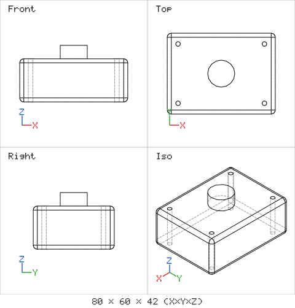

# Spike: Open CASCADE as WebAssembly in Node.js (2026-10-28)

This spike tested the likeliest starting kernel for Open3DJ: occt-wasm 5.8.1, which wraps Open CASCADE Technology (OCCT) 8.0.1 as WebAssembly, run in Node.js 22. It was run on a 4-vCPU Linux x64 cloud container. The scripts are in [spike/](spike/), and anyone can rerun them.

## Result

The kernel works in Node.js with no native build. It builds a realistic part, survives a STEP round trip with the volume unchanged, and renders an agent-readable drawing on the CPU.

| Operation | Time |
|---|---|
| Kernel start, cold | 136 ms |
| Box | 2.6 ms |
| Fillet 12 edges, 3 mm | 50 ms |
| Cut 4 holes one by one | 102 ms |
| Cut 4 holes in one batch with `cutAll` | 79 ms |
| Fuse a boss | 9 ms |
| Volume | 7 ms |
| Tessellate for display | 36 ms |
| Export STEP, 83 kB | 71 ms |
| Import STEP | 100 ms |
| Fuse 200 overlapping boxes one by one | 17,515 ms |
| Fuse the same 200 boxes in one batch with `fuseAll` | 708 ms |
| Four-view hidden-line drawing as SVG | 89 ms |
| Same drawing as PNG | 164 ms |

The process used about 440 MB of resident memory after the run. The test part had a volume of 154,286.799 mm³ before and after the STEP round trip. Both the part and the 200-box union passed the kernel's validity check.

## What this means for the plan

1. **Typical agent edits are fast enough.** Single operations on a real part take tens of milliseconds. A full rebuild of a small part plus checks fits well under one second.
2. **Batch operations matter.** Sequential booleans on a growing shape get slow. The DSL should collect cutters and fuse or cut them in one call, and the agent guide should teach this.
3. **The kernel prints to standard output.** The STEP writer prints transfer statistics to stdout. The MCP stdio transport uses stdout for its messages, so the kernel must run in a worker thread or child process whose output is captured. This is a hard requirement for the MCP server.
4. **Agents get pictures for free.** `toMultiviewSVG` and `toMultiviewPNG` render front, top, right and isometric views with hidden lines and a size label, with no GPU. This can be the default render returned to agents and used for golden-image tests in CI.
5. **The API covers far more than the first release needs.** The 210 methods include `draft` for injection-moulding draft angles, history-tracking variants of booleans, fillets and transforms for stable references, `subShapeHashes`, healing, curvature, inertia, sections, hidden-line projection for drawings, XCAF assemblies, STEP and STL import and export.
6. **Gaps to fill above the kernel:** there is no glTF export in this build, so the viewer needs a small mesh-to-glTF step. Wall-thickness and overhang checks must be written on top of the kernel.

## Multi-core CPU

occt-wasm 5.8.1 is built single-threaded: its loader has no SharedArrayBuffer, pthread or Atomics code. One kernel instance uses one CPU core. To use several cores, Open3DJ runs several kernel instances, one per worker thread, each with its own WebAssembly memory.

A pool benchmark ran 96 rebuilds of a parametric part, each a filleted box with four holes cut in one batch and a fused boss, spread over 1 to 4 workers. Each worker released its intermediate shapes after every rebuild.

| Workers | Rebuilds per second | Speedup |
|---|---|---|
| 1 | 33.2 | 1.00 |
| 2 | 48.5 | 1.46 |
| 3 | 49.1 | 1.48 |
| 4 | 55.5 | 1.67 |

The container has 4 vCPUs, but two other research workflows were running on it at the same time, so these speedups understate what an idle machine would give. A single rebuild takes about 30 ms. The pool raises throughput for batches such as parameter sweeps, best-of-N candidates and assembly regeneration. It does not make one operation faster. The benchmark scripts are [spike/pool_worker.mjs](spike/pool_worker.mjs) and [spike/pool_bench.mjs](spike/pool_bench.mjs).

## Licences

- occt-wasm tooling and TypeScript code: MIT OR Apache-2.0.
- The compiled `occt-wasm.wasm` file: LGPL-2.1-only, because it contains OCCT. Open3DJ can ship it unmodified as a separate file next to MIT-licensed code. Anyone changing it must provide the changed source, as the LGPL requires.
- brepjs 20.11.1: Apache-2.0.
- @modelcontextprotocol/sdk 1.32.2: the official MCP TypeScript SDK.

## Not tested yet

- Memory growth over thousands of edits, and the cost of `release()` and checkpoints.
- Determinism across machines and between runs.
- Windows and macOS. The package is pure WebAssembly, so this is expected to work, but it must be checked in CI.
- brepjs's higher-level API and its `KernelAdapter` seam.
