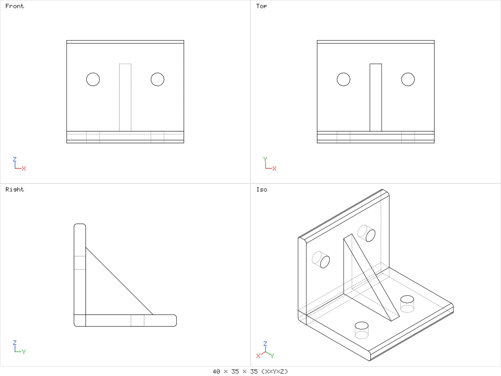
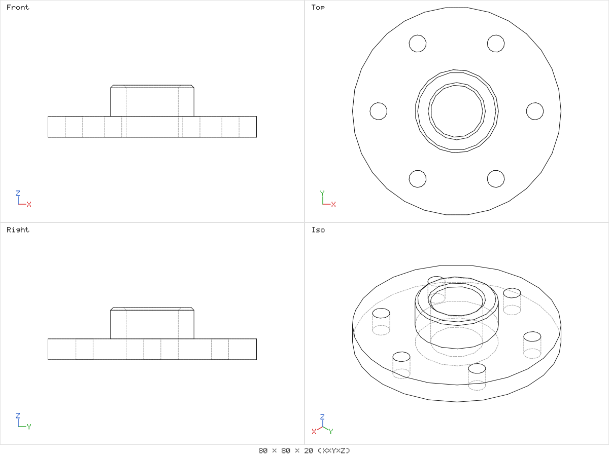
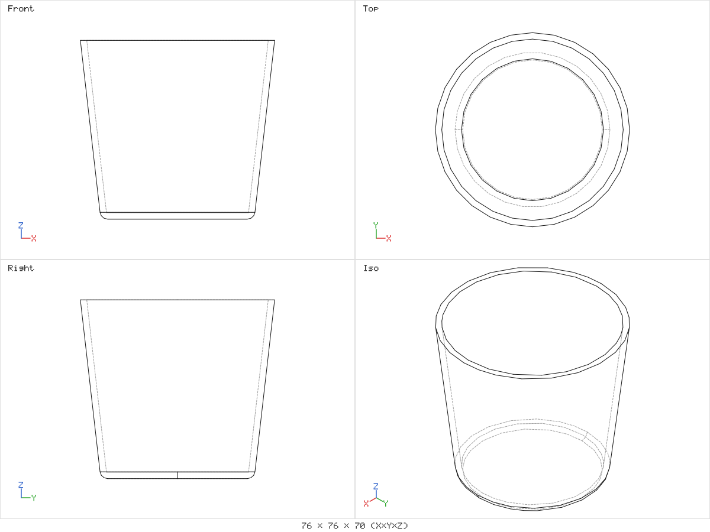
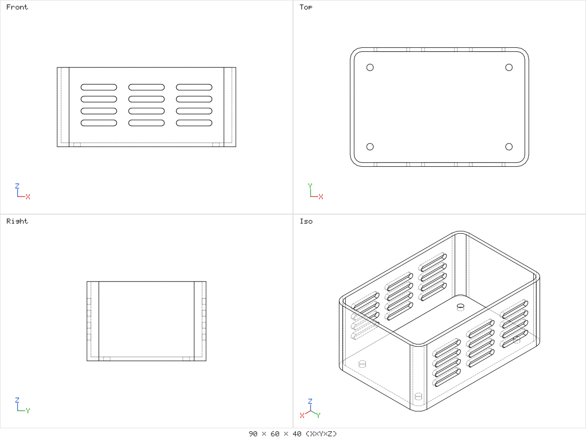
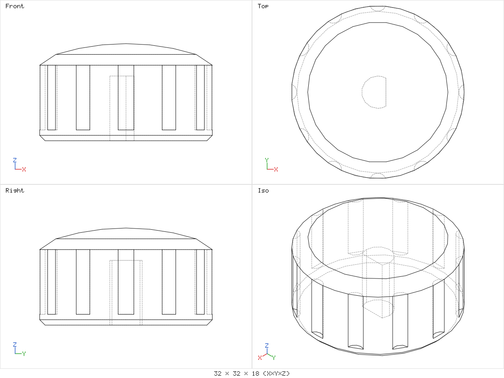
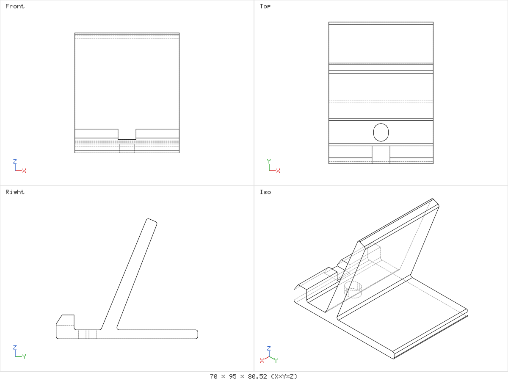
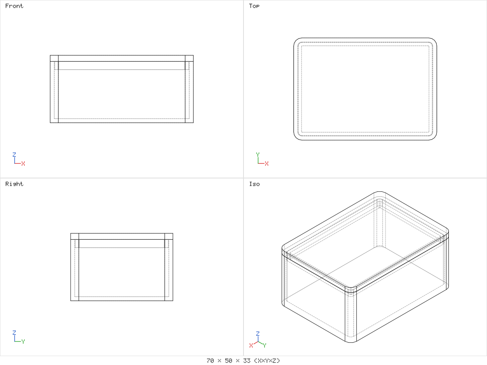
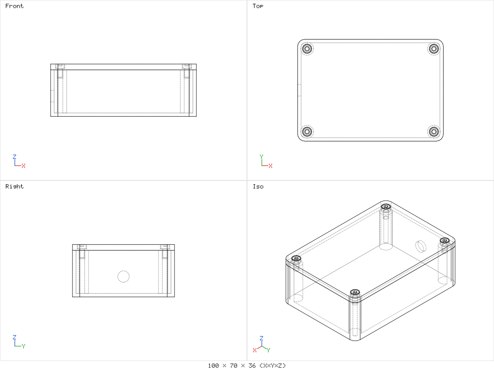
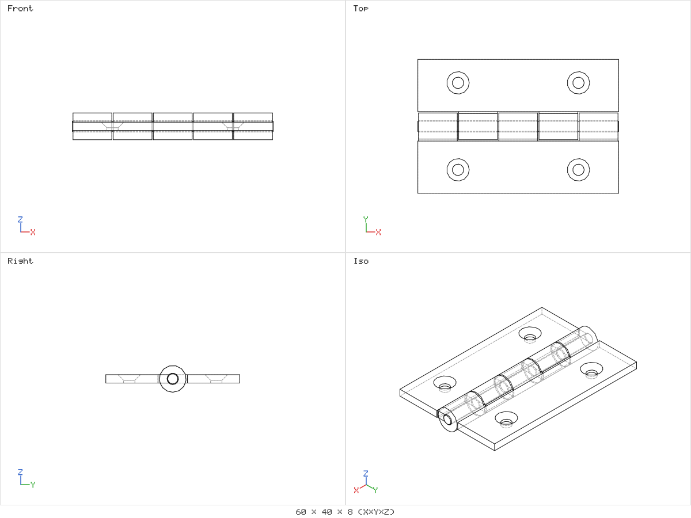
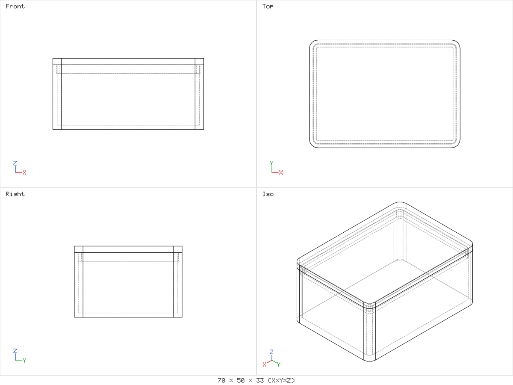

# Examples

Ten small parts and assemblies that show what Open3DJ can do today and that you can use to test it. Each folder holds one script (`<name>.o3j.js`), the measures it must produce (`expected.json`) and its four-view drawing (`drawing.png`). All examples are original, written for Open3DJ by neuraldeep.net design agents, and MIT licensed like the rest of the repository.

Run one from the repository root after `npm ci`:

```sh
npx open3dj run examples/bracket/bracket.o3j.js                  # GeometryReport, revision r_0001
npx open3dj render examples/bracket/bracket.o3j --out bracket.png  # four-view drawing
npx open3dj export examples/bracket/bracket.o3j --format step      # also stl, glb, 3mf
```

The first run creates the project folder `examples/bracket/bracket.o3j/` next to the script. It holds the revisions, the reports and everything under `out/`. Git ignores these folders. Change a parameter without editing the script with `--param`, for example `npx open3dj run examples/flange/flange.o3j.js --param "Bolt holes=8"`. The value is saved in the project's `params.o3j.json`, so later runs of the same script keep it. Delete the project folder to go back to the defaults; editing the script also starts from its defaults again.

Units are millimetres and Z is up. Volumes are for the whole assembly, so they count every occurrence. Mass in the reports assumes PLA at 1.24 g/cm3.

## Gallery

### bracket

A corner bracket: an L-angle with a centre gusset, two M4 clearance holes in each flange, and 1 mm fillets on the long outer edges. One part, 40 x 35 x 35 mm, 11320.6 mm3, valid, 26 faces.



### flange

A bolt flange: an 80 mm disc with a raised hub, a 20 mm bore, a circular pattern of six M6 clearance holes, and 1 mm chamfers on the hub and the bore. One part, 80 x 80 x 20 mm, 41856.3 mm3, valid. This matches a hand calculation: disc plus hub, minus the bore, the holes and the two chamfers.



### tapered-cup

A tapered cup lofted from a 60 mm circle to a 76 mm circle, with a cavity lofted one wall smaller at every height and a 3 mm fillet on the base edge. One part, 76 x 76 x 70 mm, 41739.1 mm3, valid. This is within 0.01 % of two frustums minus the fillet.



### vented-box

A vented project box: an open tray made with `shell()`, three columns of four vent slots through both long walls (`linearPattern`), and four M3 holes in the floor. One part, 90 x 60 x 40 mm, 29705.9 mm3, valid, 215 faces.



### knob

A lathe-style knob: a revolved profile drawn with `path()` and a domed top, twelve grip flutes (`circularPattern`), and a D-shaped bore for a 6 mm shaft. One part, 32 x 32 x 18 mm, 12498.5 mm3, valid. The dome is an arc centred on the axis, so the STEP file re-imports as the same solid.



### phone-stand

A phone stand: a side profile drawn with `polygon()` and extruded to 70 mm, with a front lip, a backrest leaning back, a cable slot through the base, a notch in the lip and 1.5 mm fillets on the long edges. One part, 70 x 95 x 80.5 mm, 92790.9 mm3, valid.



### box-with-lid

A two-part box. The base is shelled with 2 mm walls. The lid is a 3 mm plate with a locating lip below it: a ring 1.6 mm wide and 4 mm deep, made with a 2D `subtract`, that clears the inner wall by 0.25 mm. Connectors and `matchTo` seat the lid on the rim and record a fastened mate. Two occurrences of two definitions, 70 x 50 x 33 mm, 31504.8 mm3 (base 19676.1, lid 11828.7, the lid checked by hand in the regression test), status ok. The fit check reports no fits here: it keeps one result per pair, at the smallest distance, and the lid resting on the rim is a contact that the mate exempts.



### enclosure

An electronics enclosure with a base, a lid and four M3 x 6 socket head screws from `lib.bolt`. The base has corner bosses with M3 heat-set pockets (`lib.heatSetPocket`) and a cable hole. The lid has counterbored holes (`lib.screwCutter`) and is seated on the rim by connectors. The screws are clones of one screw, so the assembly has 6 occurrences of 3 definitions. 100 x 70 x 36 mm, 74550.7 mm3, status ok. The fits are clean: 4 contacts (screw heads on the counterbore floors) and 4 clearances of 0.5 mm (screw tips inside the pockets), and no clash.



### hinge

A butt hinge: two leaves with alternating knuckles, two countersunk M3 holes in each leaf, and a pin along the hinge axis. Three occurrences of three definitions, 60 x 40 x 8 mm, 7391.7 mm3, status ok. The fit check finds 3 clearances and no clash: 0.4 mm between the leaves and 0.2 mm between the pin and each leaf.



### lid-interference (negative test)

The box-with-lid design with the lip 0.3 mm wider than the cavity on each side. It exists to prove that the fit check catches a bad fit. The run ends with status warning and one clash between base and lid of 265.8 mm3. The regression test fails if this clash ever goes missing.



## Summary

| Example | Status | Occurrences / definitions | Size (mm) | Volume (mm3) | Fits |
|---|---|---|---|---|---|
| bracket | ok | 1 / 1 | 40 x 35 x 35 | 11320.6 | none |
| flange | ok | 1 / 1 | 80 x 80 x 20 | 41856.3 | none |
| tapered-cup | ok | 1 / 1 | 76 x 76 x 70 | 41739.1 | none |
| vented-box | ok | 1 / 1 | 90 x 60 x 40 | 29705.9 | none |
| knob | ok | 1 / 1 | 32 x 32 x 18 | 12498.5 | none |
| phone-stand | ok | 1 / 1 | 70 x 95 x 80.5 | 92790.9 | none |
| box-with-lid | ok | 2 / 2 | 70 x 50 x 33 | 31504.8 | none (mated contact) |
| enclosure | ok | 6 / 3 | 100 x 70 x 36 | 74550.7 | 4 contacts, 4 clearances |
| hinge | ok | 3 / 3 | 60 x 40 x 8 | 7391.7 | 3 clearances |
| lid-interference | warning | 2 / 2 | 70 x 50 x 33 | 31526.4 | 1 clash (expected) |

## How long a fresh run takes

Measured on 2026-10-28 on a shared Linux container with 4 vCPUs and 15 GB of RAM, Node 24.22.1. Your numbers will differ; `npm run examples` prints them for your machine.

A fresh command is one `npx open3dj ...` process, started after deleting the project folder. Most of its time goes to starting Node, a worker thread and the kernel, so even the simplest part takes over a second. Each export re-runs the script, because workers keep no state between jobs.

| Example | run (ms) | render PNG (ms) | export step / stl / glb / 3mf (ms) |
|---|---|---|---|
| box-with-lid | 1595 | 1665 | 1884 / 1398 / 1279 / 1382 |
| bracket | 1200 | 1364 | 1660 / 1160 / 1182 / 1148 |
| enclosure | 2012 | 2480 | 2761 / 2117 / 2270 / 2163 |
| flange | 1160 | 1481 | 1810 / 1134 / 1104 / 1177 |
| hinge | 1701 | 2075 | 2598 / 1791 / 1816 / 1821 |
| knob | 1578 | 1902 | 2155 / 1590 / 1631 / 1661 |
| lid-interference | 1376 | 1602 | 1940 / 1361 / 1378 / 1428 |
| phone-stand | 1227 | 1517 | 1875 / 1318 / 1238 / 1291 |
| tapered-cup | 1396 | 1609 | 1948 / 1475 / 1426 / 1480 |
| vented-box | 2133 | 2635 | 2859 / 2459 / 2360 / 2692 |

The MCP server keeps its workers warm, so an agent waits only for the job itself. On a warm worker (second run of the same job, one worker):

| Example | run (ms) | render PNG (ms) | export STEP (ms) |
|---|---|---|---|
| box-with-lid | 325 | 409 | 262 |
| bracket | 99 | 296 | 125 |
| enclosure | 784 | 1049 | 736 |
| flange | 83 | 245 | 109 |
| hinge | 498 | 857 | 621 |
| knob | 406 | 718 | 534 |
| lid-interference | 164 | 324 | 216 |
| phone-stand | 162 | 329 | 246 |
| tapered-cup | 231 | 456 | 285 |
| vented-box | 634 | 1294 | 938 |

## Tests and how to update them

`scripts/examples.test.ts` runs every example on the real worker pool as part of `npm run check`. It compares status, solid, face and edge counts and fits exactly. It compares volume, area, bounding boxes and fit measures within 1e-6 relative, or 1e-4 when the script uses fillets or lofts. It also checks that every example exports STEP, STL, glTF and 3MF, that no example except lid-interference has a clash, and that lid-interference still has one.

If you change an example, or a kernel change moves the numbers on purpose, regenerate the expected files and the drawings, then review the diff:

```sh
node scripts/examples.ts --write     # rewrites expected.json and drawing.png through the CLI
node scripts/examples.ts             # checks every example and prints the timing table
```

A new example is a folder `examples/<name>/` with `<name>.o3j.js`. Run `--write`, look at the drawing, and add a section to this page.
